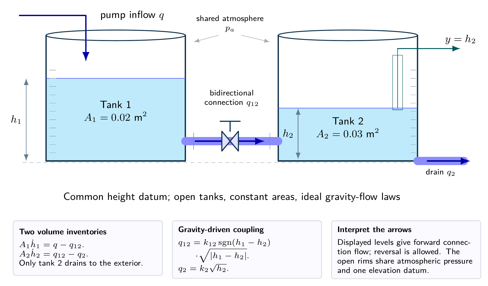
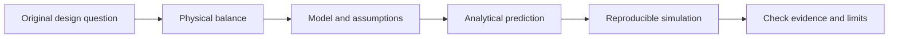

# Control of Dynamical Systems

### Original learning materials, worked reasoning and reproducible simulations

[](https://github.com/fobos123deimos/Undergraduate-Course-Control-of-Dynamical-Systems/actions/workflows/validate.yml)


A newly written English collection of twelve computational laboratories, 60 integrated laboratory problems and five cross-topic design studies. Each scenario has its own design brief, stated hypothetical parameters, worked derivation and model limitations. All datasets and figures are synthetic unless a future contribution explicitly documents measured evidence.

This is an original teaching collection created for this repository. Earlier course documents informed only the choice of broad subjects. Their worksheets, translated question lists, figures, source files and administrative content are not part of this edition. Standard control methods are referenced rather than claimed as new discoveries. See [authorship and scope](docs/AUTHORSHIP.md).

> Course-context acknowledgment: [Wilkley Bezerra Correia — Currículo Lattes](http://lattes.cnpq.br/3485468084858036), identifier corroborated by the [official directory](https://ccee.ufc.br/pt/colegiado-do-curso/). This link is retained at the repository owner's request; it does not attribute authorship, review or endorsement of this new collection to the professor.

## Navigation

- [Illustrated Python API reference](https://fobos123deimos.github.io/Undergraduate-Course-Control-of-Dynamical-Systems/) · [Versioned HTML](docs/api/index.html) · [Build and maintenance](docs/API_DOCUMENTATION.md)
- [Learning path, prerequisites and course guide](course/README.md)
- [Repository review and remaining limitations](docs/REVIEW.md)
- [General collection: five integrated design studies (PDF)](problem-sets/integrated-design/exercises.pdf) and [worked solutions (PDF)](problem-sets/integrated-design/solutions.pdf)
- [Laboratory practice: 12 sets of five problems with linked parts and worked solutions](problem-sets/README.md)
- [References and English/Portuguese video lessons](docs/REFERENCES.md)
- [Assumptions and limitations](docs/LIMITATIONS.md)
- [Control diagrams: illustrated gallery and PDF atlas](docs/DIAGRAMS.md)
- [Mathematical notation review](docs/NOTATION.md)
- [Execution and document validation](docs/VALIDATION.md)

## Computational laboratories

| Module | Topic | Report | Notebook | Exercises | Solutions |
|---|---|---|---|---|---|
| 01 | [Thermal enclosure and a slow sensor](laboratories/01-thermal-enclosure/README.md) | [PDF](laboratories/01-thermal-enclosure/report.pdf) | [Colab](https://colab.research.google.com/github/fobos123deimos/Undergraduate-Course-Control-of-Dynamical-Systems/blob/main/laboratories/01-thermal-enclosure/notebook.ipynb) | [PDF](laboratories/01-thermal-enclosure/exercises.pdf) | [PDF](laboratories/01-thermal-enclosure/exercise-solutions.pdf) |
| 02 | [Ventilation as a bilinear dynamical system](laboratories/02-ventilation/README.md) | [PDF](laboratories/02-ventilation/report.pdf) | [Colab](https://colab.research.google.com/github/fobos123deimos/Undergraduate-Course-Control-of-Dynamical-Systems/blob/main/laboratories/02-ventilation/notebook.ipynb) | [PDF](laboratories/02-ventilation/exercises.pdf) | [PDF](laboratories/02-ventilation/exercise-solutions.pdf) |
| 03 | [A precision platform under floor motion](laboratories/03-vibration-isolation/README.md) | [PDF](laboratories/03-vibration-isolation/report.pdf) | [Colab](https://colab.research.google.com/github/fobos123deimos/Undergraduate-Course-Control-of-Dynamical-Systems/blob/main/laboratories/03-vibration-isolation/notebook.ipynb) | [PDF](laboratories/03-vibration-isolation/exercises.pdf) | [PDF](laboratories/03-vibration-isolation/exercise-solutions.pdf) |
| 04 | [A passive notch filter and component tolerance](laboratories/04-notch-filter/README.md) | [PDF](laboratories/04-notch-filter/report.pdf) | [Colab](https://colab.research.google.com/github/fobos123deimos/Undergraduate-Course-Control-of-Dynamical-Systems/blob/main/laboratories/04-notch-filter/notebook.ipynb) | [PDF](laboratories/04-notch-filter/exercises.pdf) | [PDF](laboratories/04-notch-filter/exercise-solutions.pdf) |
| 05 | [Flywheel speed regulation under a load torque](laboratories/05-motor-load-rejection/README.md) | [PDF](laboratories/05-motor-load-rejection/report.pdf) | [Colab](https://colab.research.google.com/github/fobos123deimos/Undergraduate-Course-Control-of-Dynamical-Systems/blob/main/laboratories/05-motor-load-rejection/notebook.ipynb) | [PDF](laboratories/05-motor-load-rejection/exercises.pdf) | [PDF](laboratories/05-motor-load-rejection/exercise-solutions.pdf) |
| 06 | [Gain selection with a third-order actuator](laboratories/06-root-locus/README.md) | [PDF](laboratories/06-root-locus/report.pdf) | [Colab](https://colab.research.google.com/github/fobos123deimos/Undergraduate-Course-Control-of-Dynamical-Systems/blob/main/laboratories/06-root-locus/notebook.ipynb) | [PDF](laboratories/06-root-locus/exercises.pdf) | [PDF](laboratories/06-root-locus/exercise-solutions.pdf) |
| 07 | [A feedback loop with a communication delay](laboratories/07-delay-budget/README.md) | [PDF](laboratories/07-delay-budget/report.pdf) | [Colab](https://colab.research.google.com/github/fobos123deimos/Undergraduate-Course-Control-of-Dynamical-Systems/blob/main/laboratories/07-delay-budget/notebook.ipynb) | [PDF](laboratories/07-delay-budget/exercises.pdf) | [PDF](laboratories/07-delay-budget/exercise-solutions.pdf) |
| 08 | [Lead-lag design for a normalized camera axis](laboratories/08-camera-compensation/README.md) | [PDF](laboratories/08-camera-compensation/report.pdf) | [Colab](https://colab.research.google.com/github/fobos123deimos/Undergraduate-Course-Control-of-Dynamical-Systems/blob/main/laboratories/08-camera-compensation/notebook.ipynb) | [PDF](laboratories/08-camera-compensation/exercises.pdf) | [PDF](laboratories/08-camera-compensation/exercise-solutions.pdf) |
| 09 | [PID regulation when the actuator saturates](laboratories/09-pid-saturation/README.md) | [PDF](laboratories/09-pid-saturation/report.pdf) | [Colab](https://colab.research.google.com/github/fobos123deimos/Undergraduate-Course-Control-of-Dynamical-Systems/blob/main/laboratories/09-pid-saturation/notebook.ipynb) | [PDF](laboratories/09-pid-saturation/exercises.pdf) | [PDF](laboratories/09-pid-saturation/exercise-solutions.pdf) |
| 10 | [Two thermal zones with one temperature measurement](laboratories/10-observer-control/README.md) | [PDF](laboratories/10-observer-control/report.pdf) | [Colab](https://colab.research.google.com/github/fobos123deimos/Undergraduate-Course-Control-of-Dynamical-Systems/blob/main/laboratories/10-observer-control/notebook.ipynb) | [PDF](laboratories/10-observer-control/exercises.pdf) | [PDF](laboratories/10-observer-control/exercise-solutions.pdf) |
| 11 | [Sampling can destabilize a continuous-time design](laboratories/11-digital-control/README.md) | [PDF](laboratories/11-digital-control/report.pdf) | [Colab](https://colab.research.google.com/github/fobos123deimos/Undergraduate-Course-Control-of-Dynamical-Systems/blob/main/laboratories/11-digital-control/notebook.ipynb) | [PDF](laboratories/11-digital-control/exercises.pdf) | [PDF](laboratories/11-digital-control/exercise-solutions.pdf) |
| 12 | [A synthetic process from identification to validation](laboratories/12-identification-capstone/README.md) | [PDF](laboratories/12-identification-capstone/report.pdf) | [Colab](https://colab.research.google.com/github/fobos123deimos/Undergraduate-Course-Control-of-Dynamical-Systems/blob/main/laboratories/12-identification-capstone/notebook.ipynb) | [PDF](laboratories/12-identification-capstone/exercises.pdf) | [PDF](laboratories/12-identification-capstone/exercise-solutions.pdf) |

## From physical systems to control models



Thirteen detailed TikZ equipment illustrations show thermal enclosures, water tanks, mechanical supports, circuits, motors and sensing paths. Each includes state and unit labels, governing balances, interpretation limits and individual vector PDFs. Shaft and pivot arrows identify their centers explicitly. Twelve control diagrams retain the corresponding mathematical structures. Each laboratory has five problems with three linked parts; the general collection has five larger cases with six parts each. All five integrated cases include their equipment views, with reuse and the links between laboratories listed in the gallery. [Browse the 25 illustrations and the PDF atlas](docs/DIAGRAMS.md).

## Reproduce the work

```bash
python -m pip install -r requirements.txt
python tools/validate.py --notebooks
python tools/validate_exercises.py
python tools/validate_integrated.py
python tools/validate_notation.py
```

The notebooks contain Markdown derivations, executable computations, numerical checks and saved figures. Open them locally or through their Colab links. The computations require no external data files. Diagram previews load from this repository. Run an individual `analysis.py` from its laboratory directory.

For MATLAB with Control System Toolbox or GNU Octave with the control package:

```matlab
addpath('matlab');
run_lesson(3);
run_lesson(10);
```

For MATLAB with Simulink, run `addpath('simulink'); build_models`. Its generator creates nominal models; inspect [Simulink scope](simulink/README.md) and [actual validation](docs/VALIDATION.md) before assuming a runtime was tested.

Compile each `.tex` file from its own directory using Tectonic or two passes of pdfLaTeX. The scientific plots are generated by the Python programs; conceptual diagrams are editable TikZ.

## Organization

```text
course/                      original study guide
laboratories/01-...12-.../    assignment, report, notebook, program and results
problem-sets/integrated-design/    new exercises and worked answers
matlab/                      portable computational counterparts
simulink/                    nominal model generator
docs/                        references, authorship, limits and validation
tools/                       repeatable validation
```



The presentation follows the owner's course-repository convention of topic folders, navigation tables, badges and mathematical documentation. The [validation record](docs/VALIDATION.md) distinguishes tested Python/Octave computations from proprietary-runtime and experimental gaps.
