# Physical systems and control models

Thirteen original physical illustrations accompany twelve existing control diagrams. Editable TikZ sources, individual vector PDFs, 2600-pixel PNG previews and the [PDF atlas](diagram-atlas.pdf) are included. Each equipment drawing identifies states, signals, units, governing balances and interpretation limits. Rotation arrows are centered on their shafts or pivots; directed paths terminate at their equipment ports. All equipment and parameters are hypothetical.

## 01. Thermal enclosure and a slow sensor

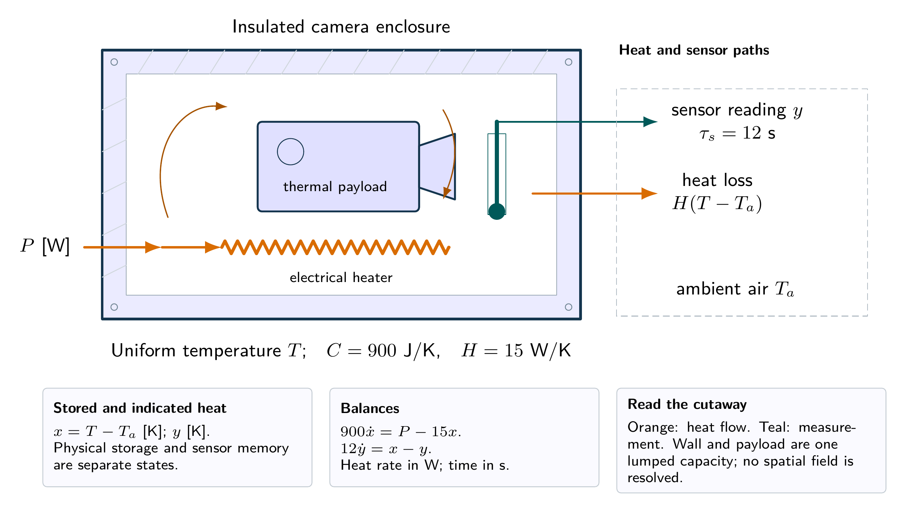

Cutaway of a lumped thermal enclosure. Orange arrows carry heat; the probe measures a lagged temperature. The drawing fixes the energy boundary, not a real device geometry.

[Vector PDF](../laboratories/01-thermal-enclosure/figures/physical-system.pdf) · [Physical TikZ](../laboratories/01-thermal-enclosure/figures/physical-system.tikz) · [Control diagram](../laboratories/01-thermal-enclosure/figures/system-diagram.png) · [Integrated problems](../laboratories/01-thermal-enclosure/exercises.pdf)

## 02. Ventilation as a bilinear dynamical system

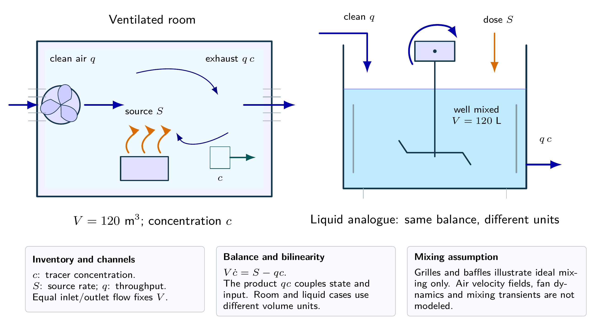

A ventilated room and a well-mixed liquid analogue share an inventory balance. The room uses m$^3$ and the liquid case uses L; do not mix their concentration or flow units. Equal inlet and outlet volume flows keep each inventory constant.

[Vector PDF](../laboratories/02-ventilation/figures/physical-system.pdf) · [Physical TikZ](../laboratories/02-ventilation/figures/physical-system.tikz) · [Control diagram](../laboratories/02-ventilation/figures/system-diagram.png) · [Integrated problems](../laboratories/02-ventilation/exercises.pdf)

## 03. A precision platform under floor motion

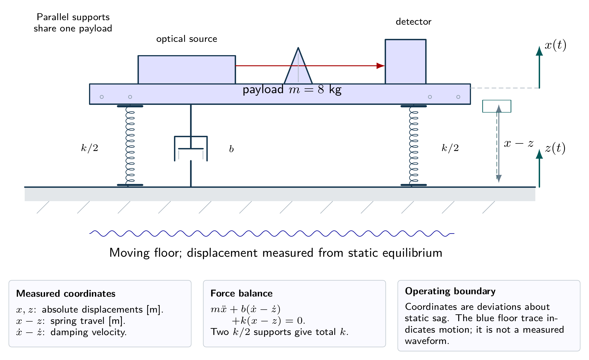

An optical payload rests on parallel spring and damping elements. The two springs each have stiffness $k/2$, giving total $k$. Both the floor and payload move; spring extension and damping velocity are relative quantities. Weight is balanced at the static equilibrium about which the model is written.

[Vector PDF](../laboratories/03-vibration-isolation/figures/physical-system.pdf) · [Physical TikZ](../laboratories/03-vibration-isolation/figures/physical-system.tikz) · [Control diagram](../laboratories/03-vibration-isolation/figures/system-diagram.png) · [Integrated problems](../laboratories/03-vibration-isolation/exercises.pdf)

## 04. A passive notch filter and component tolerance

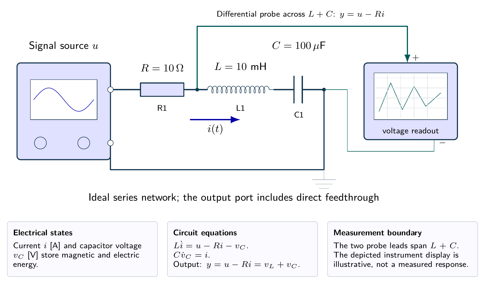

A source excites the series RLC network; an ideal differential probe spans the combined inductor and capacitor. Measuring only the capacitor would produce a different transfer function. Wire placement is schematic.

[Vector PDF](../laboratories/04-notch-filter/figures/physical-system.pdf) · [Physical TikZ](../laboratories/04-notch-filter/figures/physical-system.tikz) · [Control diagram](../laboratories/04-notch-filter/figures/system-diagram.png) · [Integrated problems](../laboratories/04-notch-filter/exercises.pdf)

## 05. Flywheel speed regulation under a load torque

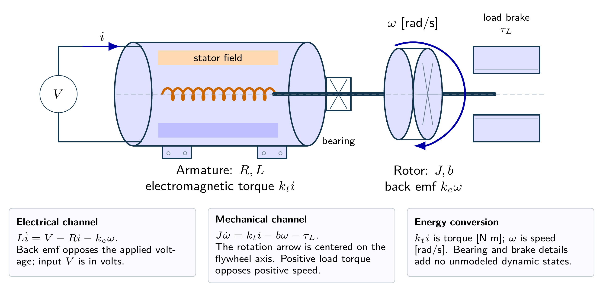

A voltage-driven motor converts armature current into shaft torque. The rotor and external brake introduce inertia, friction and load torque. The illustrative cutaway does not add magnetic saturation or friction to the stated linear model.

[Vector PDF](../laboratories/05-motor-load-rejection/figures/physical-system.pdf) · [Physical TikZ](../laboratories/05-motor-load-rejection/figures/physical-system.tikz) · [Control diagram](../laboratories/05-motor-load-rejection/figures/system-diagram.png) · [Integrated problems](../laboratories/05-motor-load-rejection/exercises.pdf)

## 06. Gain selection with a third-order actuator

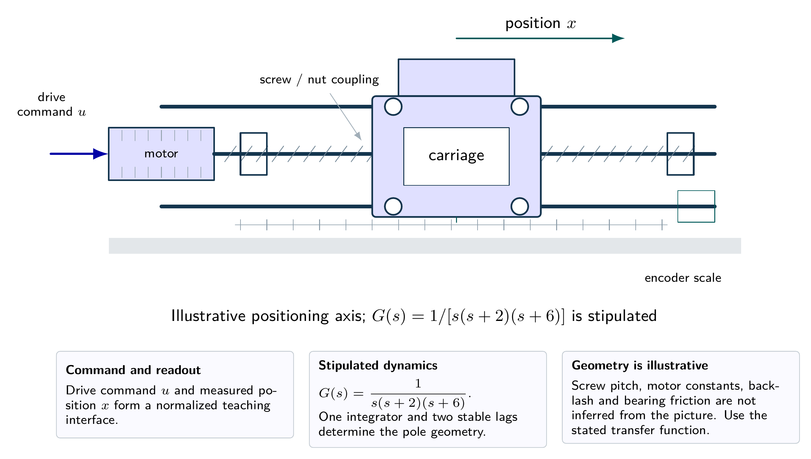

A motorized positioning axis illustrates the role of the integrator and two stable lags. The normalized transfer function is specified as a teaching model; the pictured dimensions do not identify its coefficients.

[Vector PDF](../laboratories/06-root-locus/figures/physical-system.pdf) · [Physical TikZ](../laboratories/06-root-locus/figures/physical-system.tikz) · [Control diagram](../laboratories/06-root-locus/figures/system-diagram.png) · [Integrated problems](../laboratories/06-root-locus/exercises.pdf)

## 07. A feedback loop with a communication delay

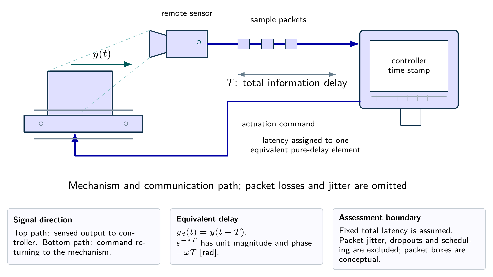

A remote mechanism sends measurements and receives commands through a communication path. The model combines those latencies into one ideal constant delay; the drawn packet train is not an experimental record.

[Vector PDF](../laboratories/07-delay-budget/figures/physical-system.pdf) · [Physical TikZ](../laboratories/07-delay-budget/figures/physical-system.tikz) · [Control diagram](../laboratories/07-delay-budget/figures/system-diagram.png) · [Integrated problems](../laboratories/07-delay-budget/exercises.pdf)

## 08. Lead-lag design for a normalized camera axis

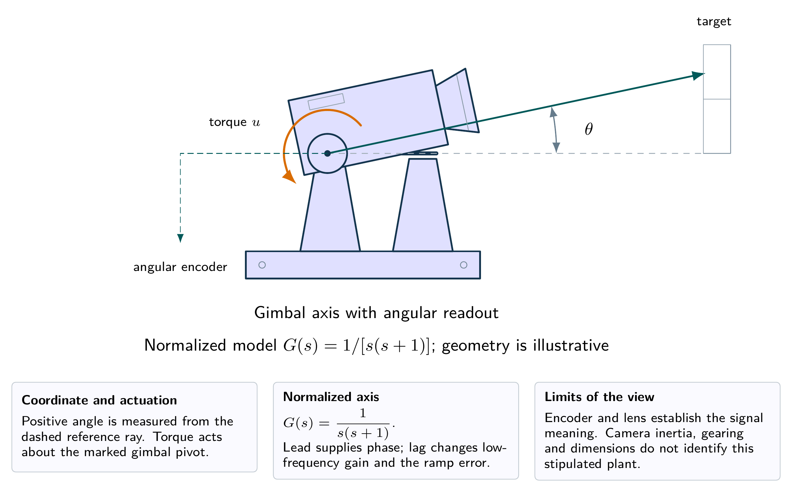

A camera gimbal illustrates angular tracking and disturbance rejection. Its normalized plant is stipulated, with no claim that geometry alone determines its two poles.

[Vector PDF](../laboratories/08-camera-compensation/figures/physical-system.pdf) · [Physical TikZ](../laboratories/08-camera-compensation/figures/physical-system.tikz) · [Control diagram](../laboratories/08-camera-compensation/figures/system-diagram.png) · [Integrated problems](../laboratories/08-camera-compensation/exercises.pdf)

## 09. PID regulation when the actuator saturates

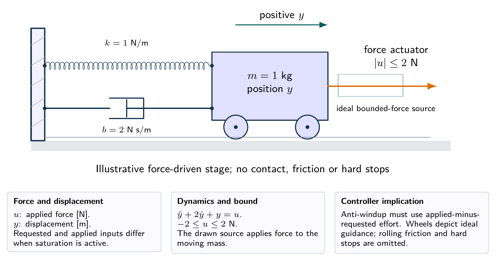

A mass, spring, damper and bounded force actuator physically realize the normalized second-order plant. Force saturation is included; contact, dry friction and travel stops are not.

[Vector PDF](../laboratories/09-pid-saturation/figures/physical-system.pdf) · [Physical TikZ](../laboratories/09-pid-saturation/figures/physical-system.tikz) · [Control diagram](../laboratories/09-pid-saturation/figures/system-diagram.png) · [Integrated problems](../laboratories/09-pid-saturation/exercises.pdf)

## 10. Two thermal zones with one temperature measurement

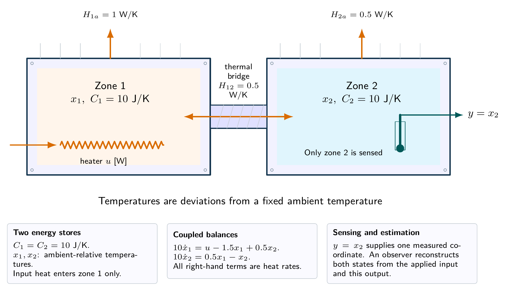

Two thermal inventories are connected by a conductive bridge. Heating acts in the first zone and sensing in the second. These stated capacities and conductances reproduce the two-state model exactly under the lumped assumptions.

[Vector PDF](../laboratories/10-observer-control/figures/physical-system.pdf) · [Physical TikZ](../laboratories/10-observer-control/figures/physical-system.tikz) · [Control diagram](../laboratories/10-observer-control/figures/system-diagram.png) · [Integrated problems](../laboratories/10-observer-control/exercises.pdf)

## 11. Sampling can destabilize a continuous-time design

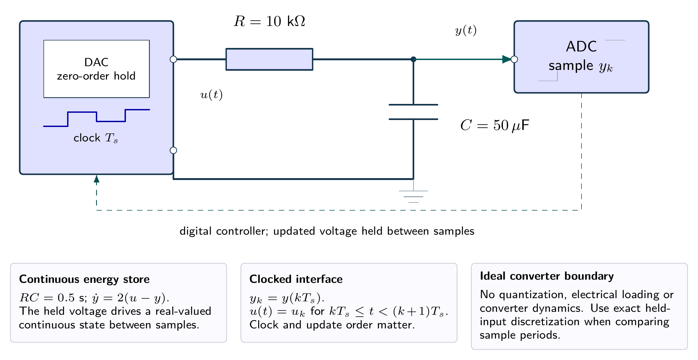

A held voltage drives an ideal RC network. The capacitor voltage is sampled by an ideal ADC; the software controller updates the DAC once per period. Quantization, converter lag and electrical loading are omitted.

[Vector PDF](../laboratories/11-digital-control/figures/physical-system.pdf) · [Physical TikZ](../laboratories/11-digital-control/figures/physical-system.tikz) · [Control diagram](../laboratories/11-digital-control/figures/system-diagram.png) · [Integrated problems](../laboratories/11-digital-control/exercises.pdf)

## 12. A synthetic process from identification to validation

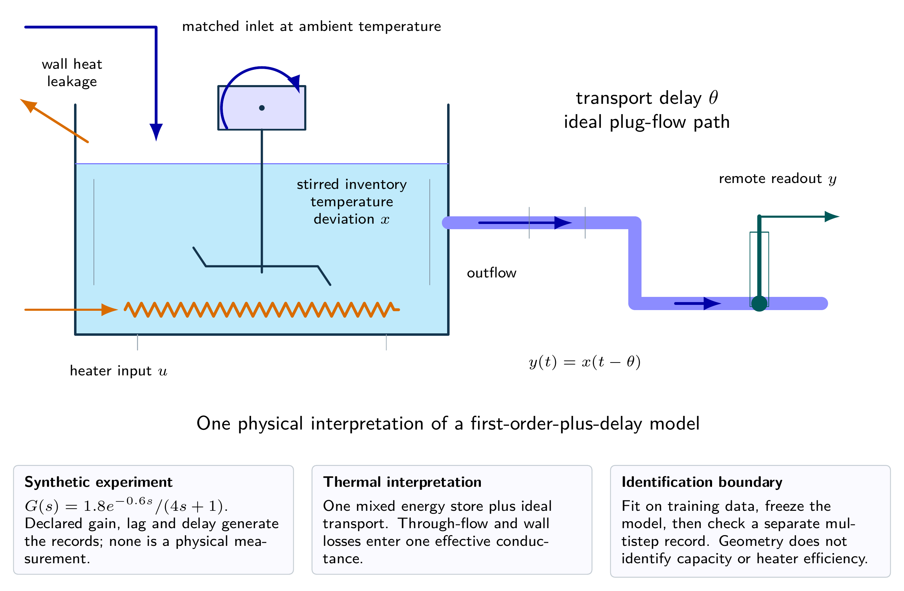

A stirred thermal inventory followed by ideal transport is one possible physical interpretation of the identified transfer function. The effective conductance includes wall leakage and through-flow heat removal. Its fitted gain and time constant do not separately determine capacity, conductance and heater efficiency.

[Vector PDF](../laboratories/12-identification-capstone/figures/physical-system.pdf) · [Physical TikZ](../laboratories/12-identification-capstone/figures/physical-system.tikz) · [Control diagram](../laboratories/12-identification-capstone/figures/system-diagram.png) · [Integrated problems](../laboratories/12-identification-capstone/exercises.pdf)

## Interacting water tanks

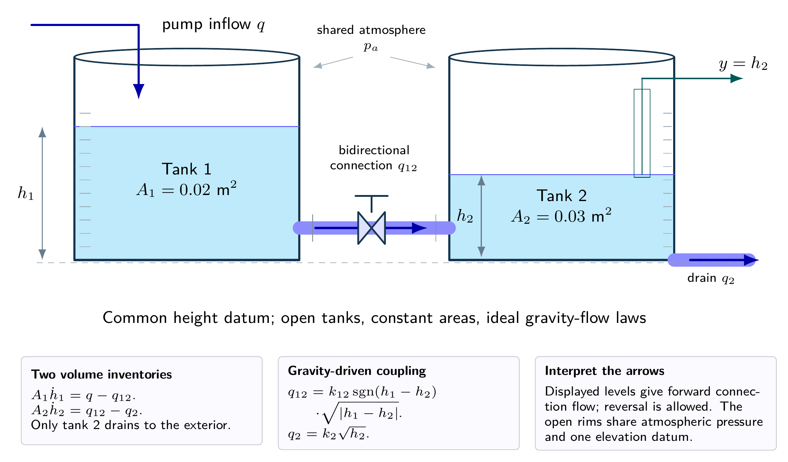

Interacting tanks share a submerged connection at a common datum. Flow reverses if the level ordering reverses. Only tank 2 drains to the exterior; this is not a cascade with a freely falling inter-tank stream.

[Vector PDF](../problem-sets/integrated-design/figures/interacting-tanks.pdf) · [Six-part design study](../problem-sets/integrated-design/exercises.pdf) · [TikZ](../problem-sets/integrated-design/figures/interacting-tanks.tikz)


## Five integrated design studies

These studies reuse the same physical models deliberately. The tank system is the thirteenth unique equipment view; the other cases combine laboratory equipment and mathematical diagrams.

| Integrated case | Equipment and model views | Connection studied |
| --- | --- | --- |
| 1. Interacting tanks | Tanks above | Nonlinear conservation, reversible coupling, PI feasibility |
| 2. Optical isolation | Laboratory 03 | Base excitation, relative travel, stiffness and damping |
| 3. Motor speed | Laboratory 05 | Electrical and mechanical storage, load and voltage limits |
| 4. Camera and network delay | Laboratories 08 and 07 | Angular tracking, lead-lag compensation, information latency |
| 5. Two zones and sampled actuation | Laboratories 10 and 11 | Estimation from one sensor, held inputs and sample timing |

Each case in the [integrated exercises](../problem-sets/integrated-design/exercises.pdf) and [worked solutions](../problem-sets/integrated-design/solutions.pdf) now includes its equipment view. The RC circuit in laboratory 11 explains sampling; it does not replace the thermal plant in case 5.

## Rebuild and verify

Use Tectonic 0.17.0 and Poppler `pdftoppm`:

```bash
python tools/build_diagrams.py --tectonic tectonic
python tools/build_diagrams.py --check
python tools/build_api_docs.py
python tools/build_api_docs.py --check
```

The drawing build regenerates 13 individual PDF/PNG pairs and every report, exercise sheet, solution and atlas that embeds the TikZ sources. `--figures-only` supports preview inspection before `--documents-only`; `--only-cached` requires a populated Tectonic bundle. [The build record](diagram-build.json) checks normalized source hashes and all committed artifact hashes, including the atlas. Numerical response plots are independent artifacts and are preserved. After editing geometry, inspect all affected renders and check text placement before recording the build.
