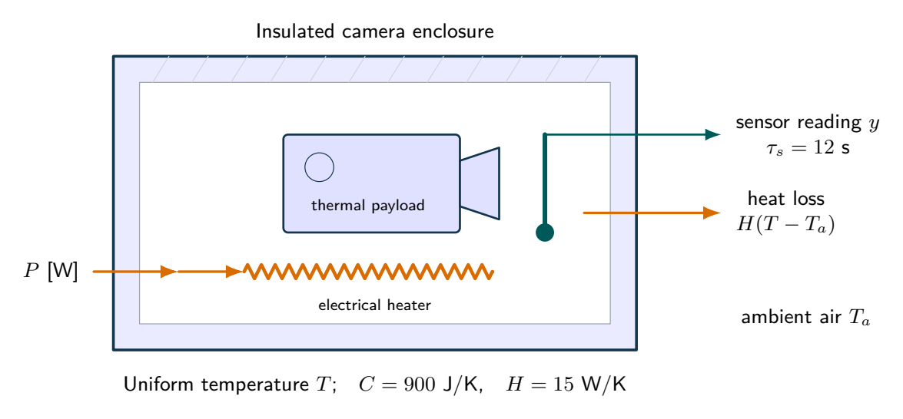
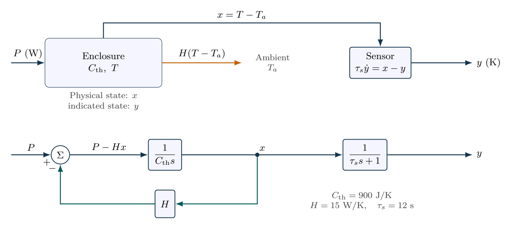

# Thermal enclosure and a slow sensor

A slow sensor can hide a thermal excursion even when its final calibration is exact. Compare physical and measured states before estimating a time constant.

- [Original assignment](assignment.md)
- [Worked report PDF](report.pdf) and [LaTeX source](report.tex)
- [Executed notebook](notebook.ipynb) and [Python program](analysis.py)
- [MATLAB / GNU Octave implementation](../../matlab/run_lesson.m): `run_lesson(1)`

Run the Python program from this folder. See [validation](../../docs/VALIDATION.md) for actual execution status.

## Practice questions

Five integrated problems each contain three linked parts: model and analyze the situation, then resolve a design or evidence question. The separate worked-solution document repeats every part and develops its reasoning. All examples use hypothetical or synthetic data.

[Questions PDF](exercises.pdf) · [Solutions PDF](exercise-solutions.pdf) · [Questions LaTeX](exercises.tex) · [Solutions LaTeX](exercise-solutions.tex)

## Physical system

Cutaway of a lumped thermal enclosure. Orange arrows carry heat; the probe measures a lagged temperature. The drawing fixes the energy boundary, not a real device geometry.

[Editable physical illustration](figures/physical-system.tikz)

## System diagram

Thermal storage, heat leakage and sensor dynamics are separate elements. The lower loop implements the energy balance, not an added temperature controller.

[Editable TikZ](figures/system-diagram.tikz) · [Diagram atlas](../../docs/diagram-atlas.pdf)

## Position in the learning path

**Before starting:** Elementary ODEs, units and Laplace transforms. **New demand:** Physical state versus sensor lag and stored energy. Noise propagation in Problem 4(b) also uses independent-error variance. See the [prerequisite map and first-pass route](../../course/README.md).
