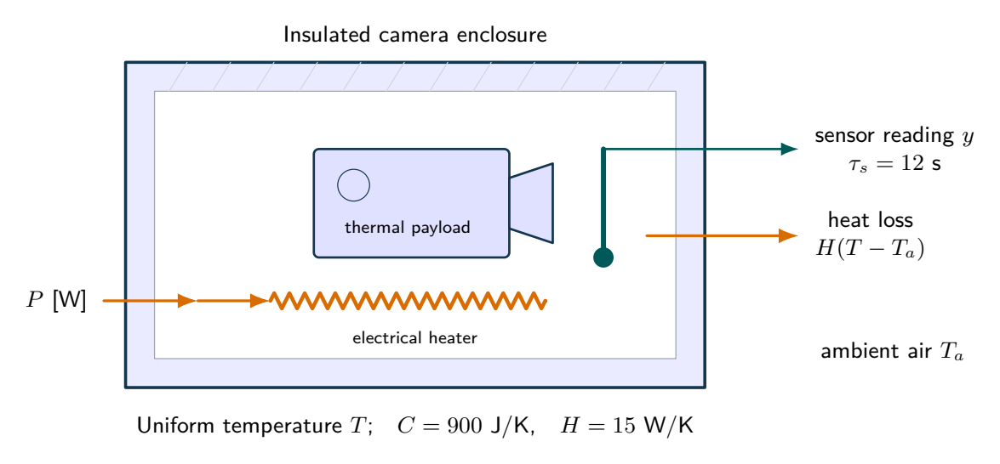
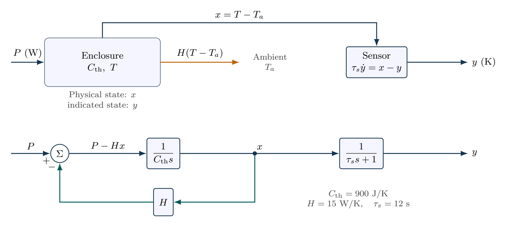

# Thermal enclosure and a slow sensor

A camera enclosure receives a $40\,\mathrm{W}$ heat increment. Use thermal capacitance $C_{\mathrm{th}}=900\,\mathrm{J/K}$, conductance $H=15\,\mathrm{W/K}$ and sensor time constant $\tau_s=12\,\mathrm{s}$. Starting at ambient temperature, derive physical rise $x=T-T_a$ and sensor indication $y$, their poles and final values, and the sensor error after one enclosure time constant.

## Physical system

Cutaway of a lumped thermal enclosure. Orange arrows carry heat; the probe measures a lagged temperature. The drawing fixes the energy boundary, not a real device geometry.

## Mathematical structure

Thermal storage, heat leakage and sensor dynamics are separate elements. The lower loop implements the energy balance, not an added temperature controller.

## Integrated practice

[Five problems with linked parts (PDF)](exercises.pdf) · [Worked reasoning (PDF)](exercise-solutions.pdf)

1. A thermal enclosure under competing design requirements
2. A reassuring sensor reading can hide stored heat
3. A heating pulse with a finite energy budget
4. Identifying a thermal process through an imperfect instrument
5. A warm start during an ambient-temperature change

All parameters define an original hypothetical scenario. Submit derivations, labeled simulations, numerical checks and model limitations. No physical experiment is implied.
