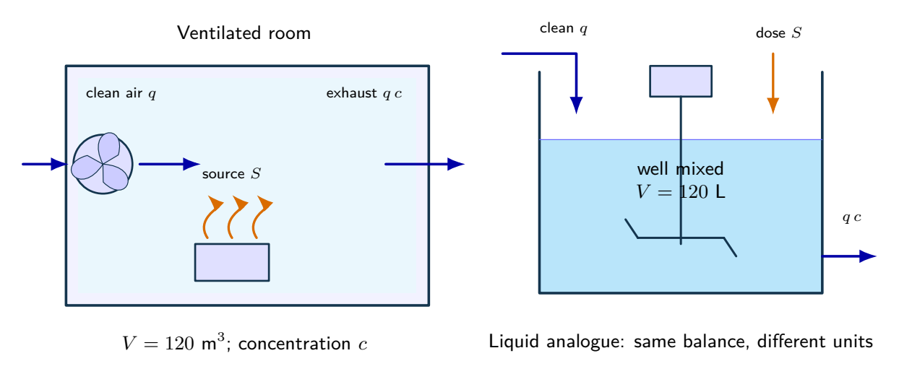
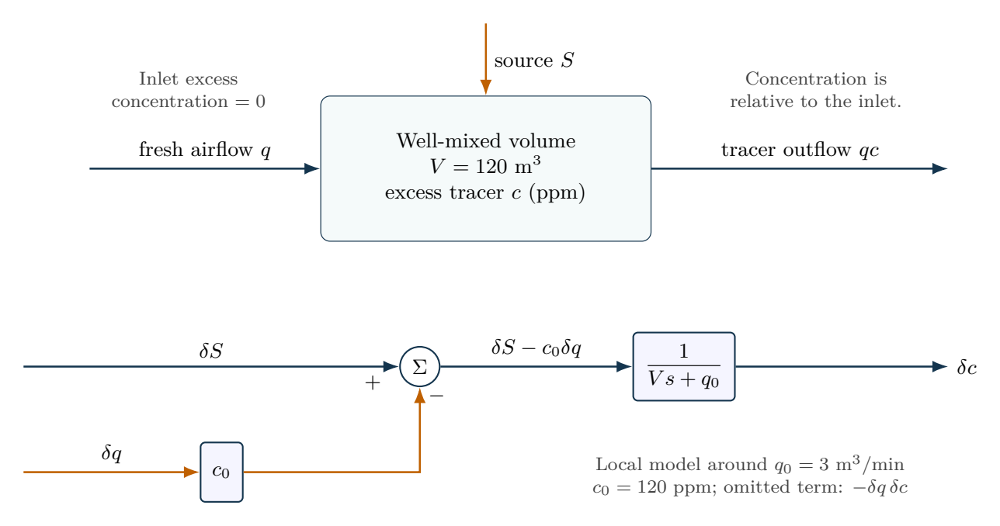

# Ventilation as a bilinear dynamical system

The doubled-flow experiment deliberately leaves the small-signal regime. Its large error is a limitation of linearization, not a numerical failure.

- [Original assignment](assignment.md)
- [Worked report PDF](report.pdf) and [LaTeX source](report.tex)
- [Executed notebook](notebook.ipynb) and [Python program](analysis.py)
- [MATLAB / GNU Octave implementation](../../matlab/run_lesson.m): `run_lesson(2)`

Run the Python program from this folder. See [validation](../../docs/VALIDATION.md) for actual execution status.

## Practice questions

Five integrated problems each contain three linked parts: model and analyze the situation, then resolve a design or evidence question. The separate worked-solution document repeats every part and develops its reasoning. All examples use hypothetical or synthetic data.

[Questions PDF](exercises.pdf) · [Solutions PDF](exercise-solutions.pdf) · [Questions LaTeX](exercises.tex) · [Solutions LaTeX](exercise-solutions.tex)

## Physical system

A ventilated room and a well-mixed liquid analogue share an inventory balance. The room uses m$^3$ and the liquid case uses L; do not mix their concentration or flow units. Equal inlet and outlet volume flows keep each inventory constant.

[Editable physical illustration](figures/physical-system.tikz)

## System diagram

The physical balance and its local two-input signal model. Airflow enters with a negative sign because increased ventilation removes excess tracer.

[Editable TikZ](figures/system-diagram.tikz) · [Diagram atlas](../../docs/diagram-atlas.pdf)

## Position in the learning path

**Before starting:** 01 and partial derivatives. **New demand:** Local approximation versus nonlinear operating points. First solve 1--3 and 5(b); return to 4 and 5(a,c) after 05, with actuator limits revisited after 09. See the [prerequisite map and first-pass route](../../course/README.md).
