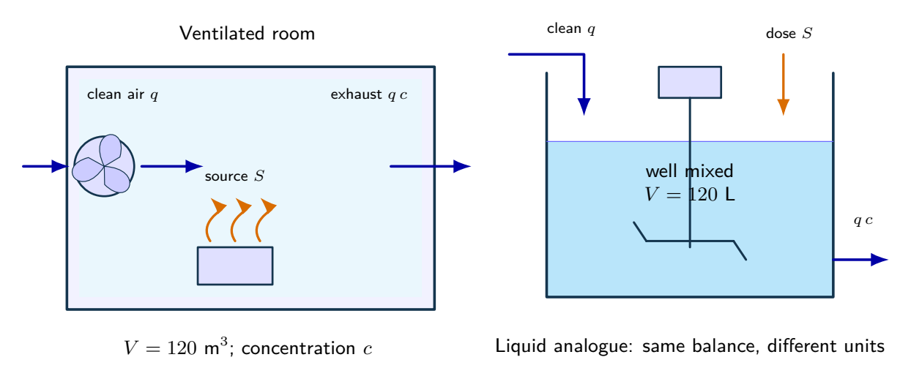
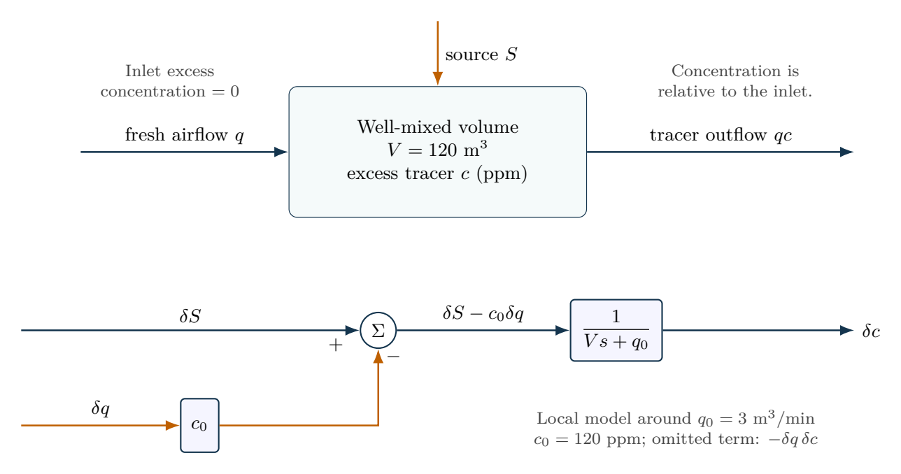

# Ventilation as a bilinear dynamical system

A hypothetical well-mixed room has $V=120\,\mathrm{m^3}$, tracer generation $S=360\,\mathrm{ppm\,m^3/min}$ and nominal airflow $q_0=3\,\mathrm{m^3/min}$. Inlet excess concentration is zero. Derive the equilibrium and local airflow-to-concentration model from $V\dot c=S-qc$. Compare $10\%$ and $100\%$ airflow increases using the nonlinear and linearized models, including their final-value errors.

## Physical system

A ventilated room and a well-mixed liquid analogue share an inventory balance. The room uses m$^3$ and the liquid case uses L; do not mix their concentration or flow units. Equal inlet and outlet volume flows keep each inventory constant.

## Mathematical structure

The physical balance and its local two-input signal model. Airflow enters with a negative sign because increased ventilation removes excess tracer.

## Integrated practice

[Five problems with linked parts (PDF)](exercises.pdf) · [Worked reasoning (PDF)](exercise-solutions.pdf)

1. From a ventilated room to a local input--output model
2. Testing a linearization with progressively larger airflow steps
3. A feedforward specification under source uncertainty
4. Choosing the feedback sign and checking the resulting operating point
5. The same balance in a stirred dilution vessel

All parameters define an original hypothetical scenario. Submit derivations, labeled simulations, numerical checks and model limitations. No physical experiment is implied.
