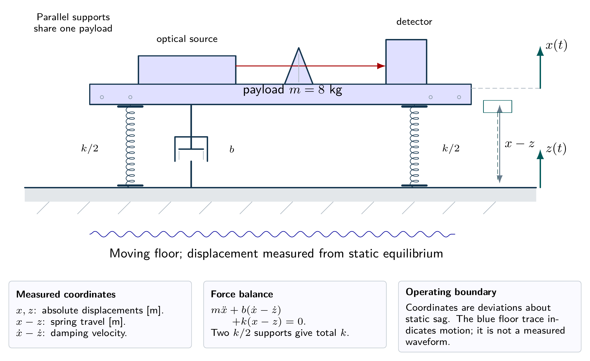
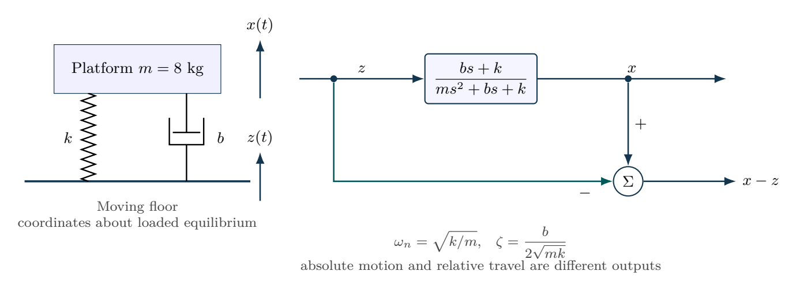

# A precision platform under floor motion

Reducing a resonance peak and improving high-frequency isolation are different design objectives. The transfer function must reflect which physical input is applied.

- [Original assignment](assignment.md)
- [Worked report PDF](report.pdf) and [LaTeX source](report.tex)
- [Executed notebook](notebook.ipynb) and [Python program](analysis.py)
- [MATLAB / GNU Octave implementation](../../matlab/run_lesson.m): `run_lesson(3)`

Run the Python program from this folder. See [validation](../../docs/VALIDATION.md) for actual execution status.

## Practice questions

Five integrated problems each contain three linked parts: model and analyze the situation, then resolve a design or evidence question. The separate worked-solution document repeats every part and develops its reasoning. All examples use hypothetical or synthetic data.

[Questions PDF](exercises.pdf) · [Solutions PDF](exercise-solutions.pdf) · [Questions LaTeX](exercises.tex) · [Solutions LaTeX](exercise-solutions.tex)

## Physical system

An optical payload rests on parallel spring and damping elements. The two springs each have stiffness $k/2$, giving total $k$. Both the floor and payload move; spring extension and damping velocity are relative quantities. Weight is balanced at the static equilibrium about which the model is written.

[Editable physical illustration](figures/physical-system.tikz) · [Vector equipment PDF](figures/physical-system.pdf)

## System diagram

Base excitation drives absolute motion; subtracting the floor coordinate gives relative travel. The spring and damper act in parallel.

[Editable TikZ](figures/system-diagram.tikz) · [Diagram atlas](../../docs/diagram-atlas.pdf)

## Position in the learning path

**Before starting:** Second-order ODEs and complex frequency response. **New demand:** Base excitation, resonance, travel and energy. Connect each transfer function to the actual input location. See the [prerequisite map and first-pass route](../../course/README.md).
