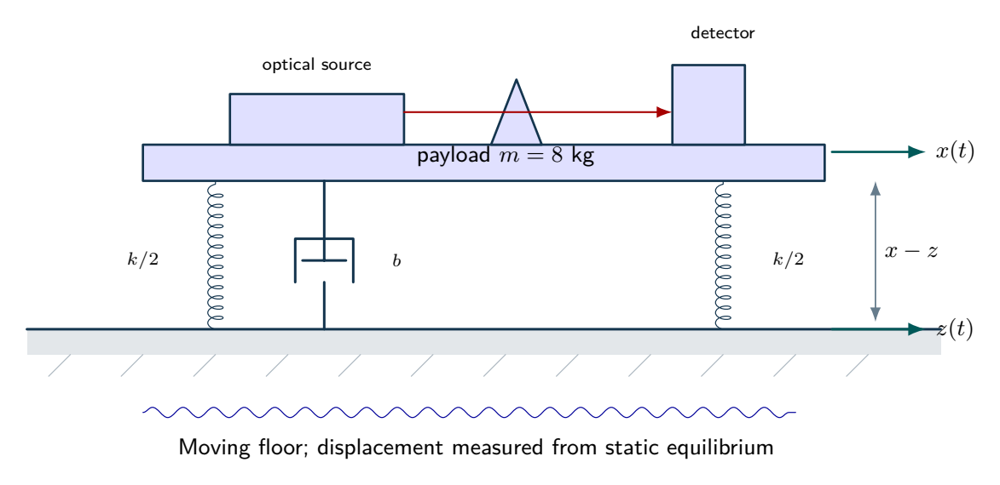
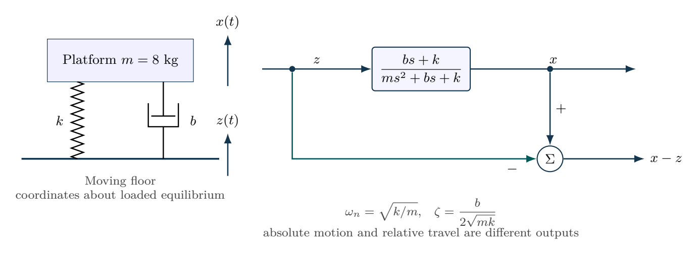

# A precision platform under floor motion

An optical platform has mass $m=8\,\mathrm{kg}$ and spring stiffness $k=3200\,\mathrm{N/m}$. Compare damping ratios $\zeta=0.08$ and $0.40$. Derive transmissibility from floor coordinate $z$ to absolute platform coordinate $x$, find the isolation threshold and compare attenuation at $\omega=2\omega_n$. Also find the displacement produced by a static $1\,\mathrm{N}$ force.

## Physical system

An optical payload rests on parallel spring and damping elements. The two springs each have stiffness $k/2$, giving total $k$. Both the floor and payload move; spring extension and damping velocity are relative quantities. Weight is balanced at the static equilibrium about which the model is written.

## Mathematical structure

Base excitation drives absolute motion; subtracting the floor coordinate gives relative travel. The spring and damper act in parallel.

## Integrated practice

[Five problems with linked parts (PDF)](exercises.pdf) · [Worked reasoning (PDF)](exercise-solutions.pdf)

1. An optical platform on a moving foundation
2. Damping a resonance while preserving isolation
3. Absolute vibration and suspension-travel limits
4. A heavier payload under a tight static-sag requirement
5. What a decay test says about energy and excitation

All parameters define an original hypothetical scenario. Submit derivations, labeled simulations, numerical checks and model limitations. No physical experiment is implied.
