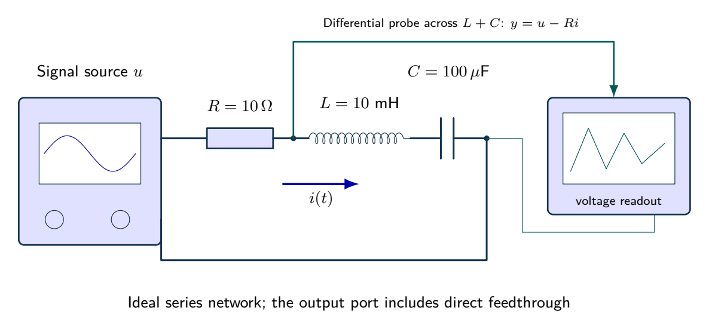
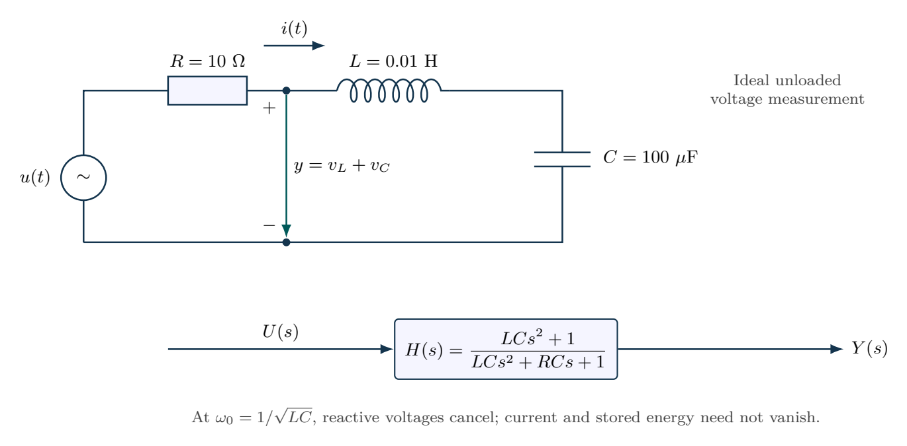

# A passive notch filter and component tolerance

Output selection changes zeros even when the physical circuit is unchanged. An ideal notch is sensitive to component tolerance and omitted losses.

- [Original assignment](assignment.md)
- [Worked report PDF](report.pdf) and [LaTeX source](report.tex)
- [Executed notebook](notebook.ipynb) and [Python program](analysis.py)
- [MATLAB / GNU Octave implementation](../../matlab/run_lesson.m): `run_lesson(4)`

Run the Python program from this folder. See [validation](../../docs/VALIDATION.md) for actual execution status.

## Practice questions

Five integrated problems each contain three linked parts: model and analyze the situation, then resolve a design or evidence question. The separate worked-solution document repeats every part and develops its reasoning. All examples use hypothetical or synthetic data.

[Questions PDF](exercises.pdf) · [Solutions PDF](exercise-solutions.pdf) · [Questions LaTeX](exercises.tex) · [Solutions LaTeX](exercise-solutions.tex)

## Physical system

A source excites the series RLC network; an ideal differential probe spans the combined inductor and capacitor. Measuring only the capacitor would produce a different transfer function. Wire placement is schematic.

[Editable physical illustration](figures/physical-system.tikz)

## System diagram

Series RLC network with output measured across L and C together. The output probe spans those two components, not the whole source.

[Editable TikZ](figures/system-diagram.tikz) · [Diagram atlas](../../docs/diagram-atlas.pdf)

## Position in the learning path

**Before starting:** 03 and basic circuit laws. **New demand:** Measured voltage, zeros, tolerance and passivity. Problem 5 previews state models; the full feedback treatment is in 10. See the [prerequisite map and first-pass route](../../course/README.md).
