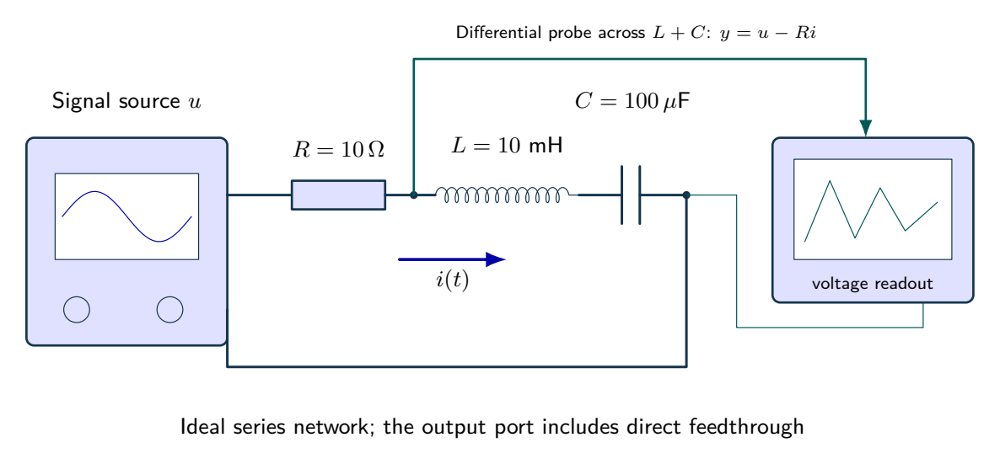
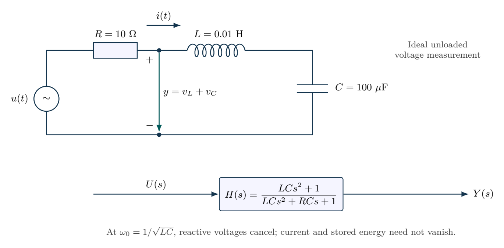

# A passive notch filter and component tolerance

An ideal voltage source drives series $R$, $L$ and $C$. Measure the combined voltage $y=v_L+v_C$. Use $L=10\,\mathrm{mH}$, $C=100\,\mu\mathrm{F}$ and $R=10\,\Omega$. Derive the notch transfer, compare it with the capacitor-voltage response, and evaluate the effect of a $\pm10\%$ capacitance tolerance. Assume ideal components and an unloaded measurement.

## Physical system

A source excites the series RLC network; an ideal differential probe spans the combined inductor and capacitor. Measuring only the capacitor would produce a different transfer function. Wire placement is schematic.

## Mathematical structure

Series RLC network with output measured across L and C together. The output probe spans those two components, not the whole source.

## Integrated practice

[Five problems with linked parts (PDF)](exercises.pdf) · [Worked reasoning (PDF)](exercise-solutions.pdf)

1. Selecting the measured voltage in a real circuit
2. A zero output with nonzero circulating energy
3. When component tolerance and winding loss spoil the notch
4. Changing damping without moving the nominal notch
5. A state model that preserves the circuit power balance

All parameters define an original hypothetical scenario. Submit derivations, labeled simulations, numerical checks and model limitations. No physical experiment is implied.
