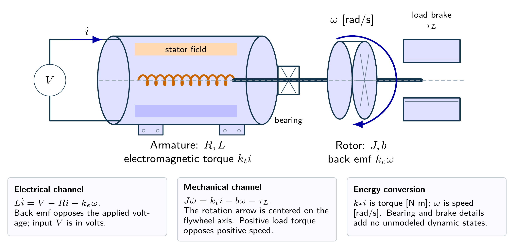
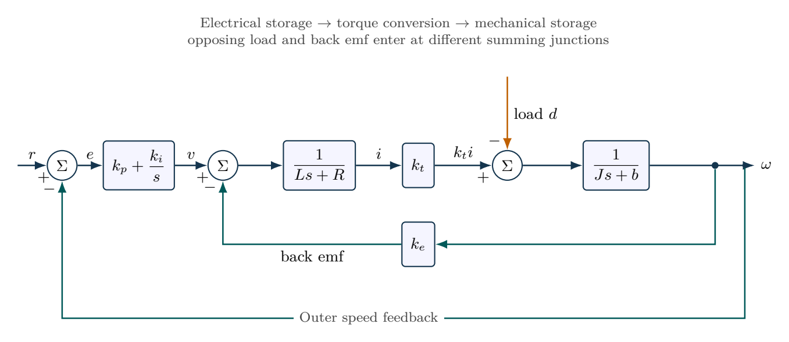

# Flywheel speed regulation under a load torque

Track the disturbance entry point as carefully as the reference path. Zero ideal steady error is conditional on stability and actuator feasibility.

- [Original assignment](assignment.md)
- [Worked report PDF](report.pdf) and [LaTeX source](report.tex)
- [Executed notebook](notebook.ipynb) and [Python program](analysis.py)
- [MATLAB / GNU Octave implementation](../../matlab/run_lesson.m): `run_lesson(5)`

Run the Python program from this folder. See [validation](../../docs/VALIDATION.md) for actual execution status.

## Practice questions

Five integrated problems each contain three linked parts: model and analyze the situation, then resolve a design or evidence question. The separate worked-solution document repeats every part and develops its reasoning. All examples use hypothetical or synthetic data.

[Questions PDF](exercises.pdf) · [Solutions PDF](exercise-solutions.pdf) · [Questions LaTeX](exercises.tex) · [Solutions LaTeX](exercise-solutions.tex)

## Physical system

A voltage-driven motor converts armature current into shaft torque. The rotor and external brake introduce inertia, friction and load torque. The illustrative cutaway does not add magnetic saturation or friction to the stated linear model.

[Editable physical illustration](figures/physical-system.tikz) · [Vector equipment PDF](figures/physical-system.pdf)

## System diagram

Outer PI speed regulation around the electromechanical motor. The inner back-emf path and opposing load torque have explicit negative signs.

[Editable TikZ](figures/system-diagram.tikz) · [Diagram atlas](../../docs/diagram-atlas.pdf)

## Position in the learning path

**Before starting:** 01--04 and P/PI feedback definitions. **New demand:** Tracking, load rejection and supply feasibility. Return to 4(a,c) after Routh analysis in 06, and 1(b) after controllability in 10. See the [prerequisite map and first-pass route](../../course/README.md).
