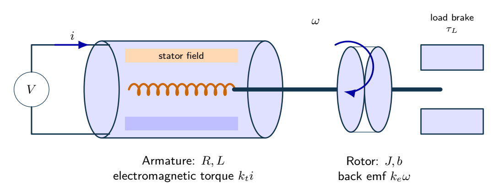
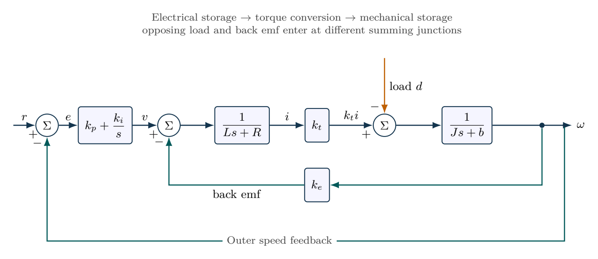

# Flywheel speed regulation under a load torque

A synthetic DC motor drives a flywheel with $R=2\,\Omega$, $L=0.02\,\mathrm{H}$, $J=0.01\,\mathrm{kg\,m^2}$, $b=0.02\,\mathrm{N\,m\,s/rad}$ and $k_t=k_e=0.1$ in consistent SI units. Derive the voltage-to-speed and opposing-load-to-speed transfers. Compare proportional gain $k_p=0.8$ with PI gains $k_p=0.8$, $k_i=1.6$ for reference $5\,\mathrm{rad/s}$ and load $0.03\,\mathrm{N\,m}$ applied at $t=4\,\mathrm{s}$. Explain the benefits and limits of integral action.

## Physical system

A voltage-driven motor converts armature current into shaft torque. The rotor and external brake introduce inertia, friction and load torque. The illustrative cutaway does not add magnetic saturation or friction to the stated linear model.

## Mathematical structure

Outer PI speed regulation around the electromechanical motor. The inner back-emf path and opposing load torque have explicit negative signs.

## Integrated practice

[Five problems with linked parts (PDF)](exercises.pdf) · [Worked reasoning (PDF)](exercise-solutions.pdf)

1. From armature current to flywheel motion
2. Checking both torque and power at the supply limit
3. Proportional tracking versus integral load rejection
4. A stable PI controller has two different closed-loop channels
5. A reduced model and a load estimate during acceleration

All parameters define an original hypothetical scenario. Submit derivations, labeled simulations, numerical checks and model limitations. No physical experiment is implied.
