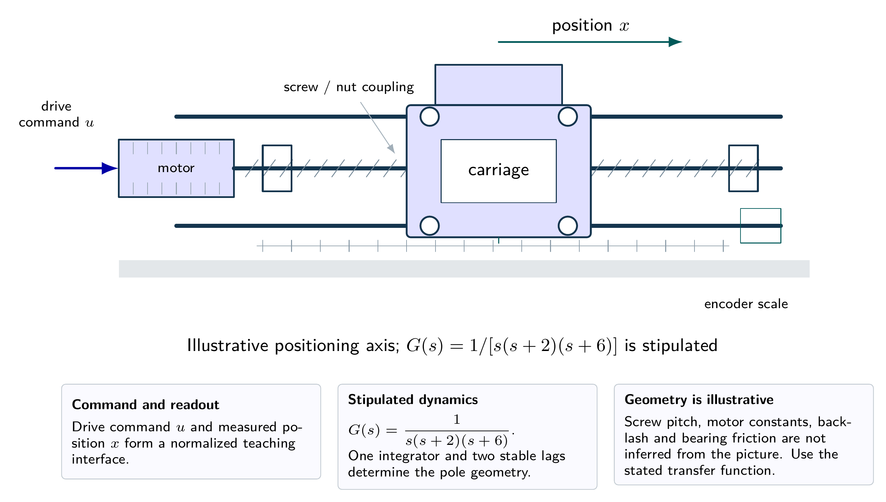
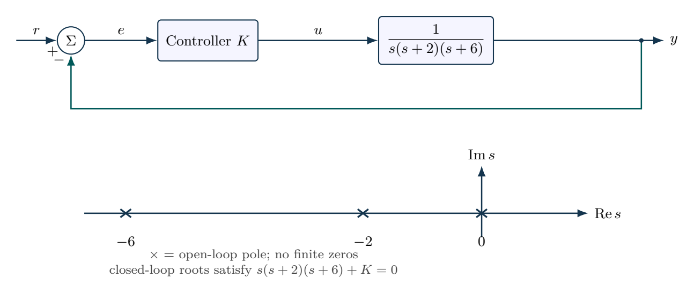

# Gain selection with a third-order actuator

An algebraic stability interval provides a guardrail for numerical tuning. The endpoint K=96 must be excluded from strict asymptotic stability.

- [Original assignment](assignment.md)
- [Worked report PDF](report.pdf) and [LaTeX source](report.tex)
- [Executed notebook](notebook.ipynb) and [Python program](analysis.py)
- [MATLAB / GNU Octave implementation](../../matlab/run_lesson.m): `run_lesson(6)`

Run the Python program from this folder. See [validation](../../docs/VALIDATION.md) for actual execution status.

## Practice questions

Five integrated problems each contain three linked parts: model and analyze the situation, then resolve a design or evidence question. The separate worked-solution document repeats every part and develops its reasoning. All examples use hypothetical or synthetic data.

[Questions PDF](exercises.pdf) · [Solutions PDF](exercise-solutions.pdf) · [Questions LaTeX](exercises.tex) · [Solutions LaTeX](exercise-solutions.tex)

## Physical system

A motorized positioning axis illustrates the role of the integrator and two stable lags. The normalized transfer function is specified as a teaching model; the pictured dimensions do not identify its coefficients.

[Editable physical illustration](figures/physical-system.tikz) · [Vector equipment PDF](figures/physical-system.pdf)

## System diagram

Unity negative feedback and the open-loop pole map. Pole symbols provide the starting geometry for the root-locus exercises.

[Editable TikZ](figures/system-diagram.tikz) · [Diagram atlas](../../docs/diagram-atlas.pdf)

## Position in the learning path

**Before starting:** 05 and characteristic polynomials. **New demand:** Algebraic stability and gain-selection limits. Do not replace a stability proof with a short time-response plot. See the [prerequisite map and first-pass route](../../course/README.md).
