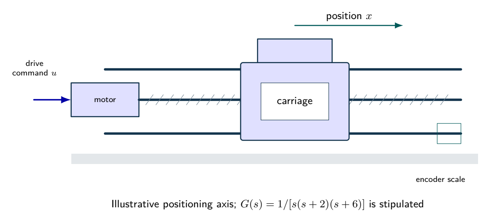
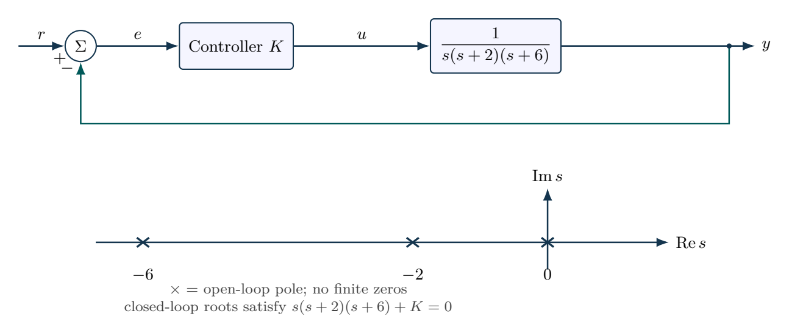

# Gain selection with a third-order actuator

A normalized actuator has $G(s)=1/[s(s+2)(s+6)]$ under unity negative feedback with proportional gain $K>0$. Derive the strictly stable gain interval using Routh--Hurwitz, the imaginary-axis crossing and real-axis breakaway. Simulate $K=12$, $60$ and $100$ to compare regulation and instability. A short time plot alone is not a stability test.

## Physical system

A motorized positioning axis illustrates the role of the integrator and two stable lags. The normalized transfer function is specified as a teaching model; the pictured dimensions do not identify its coefficients.

## Mathematical structure

Unity negative feedback and the open-loop pole map. Pole symbols provide the starting geometry for the root-locus exercises.

## Integrated practice

[Five problems with linked parts (PDF)](exercises.pdf) · [Worked reasoning (PDF)](exercise-solutions.pdf)

1. A position actuator with an identified aggregate model
2. Following branches through a breakaway
3. Boundary oscillations and feedback-sign mistakes
4. A tracking specification with gain uncertainty
5. Changing time scale and canceling a stable mode

All parameters define an original hypothetical scenario. Submit derivations, labeled simulations, numerical checks and model limitations. No physical experiment is implied.
