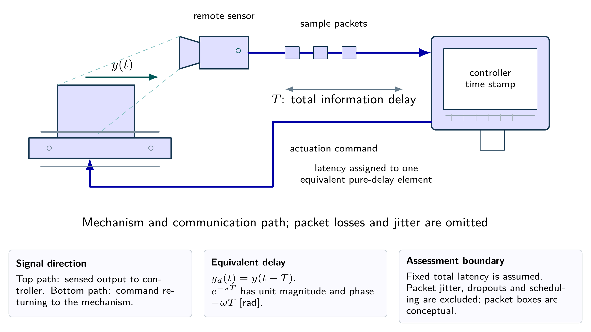
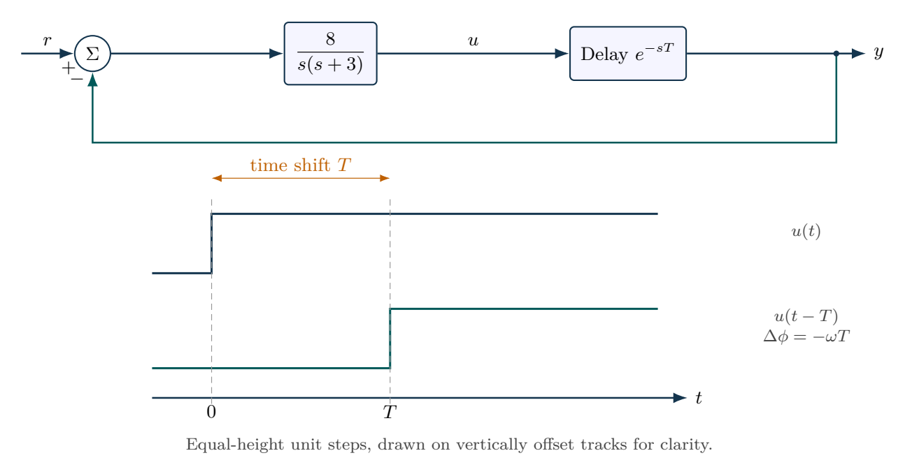

# A feedback loop with a communication delay

Exact delay phase supplies the stability-budget calculation. Pade models are checked approximations used to visualize nominal responses.

- [Original assignment](assignment.md)
- [Worked report PDF](report.pdf) and [LaTeX source](report.tex)
- [Executed notebook](notebook.ipynb) and [Python program](analysis.py)
- [MATLAB / GNU Octave implementation](../../matlab/run_lesson.m): `run_lesson(7)`

Run the Python program from this folder. See [validation](../../docs/VALIDATION.md) for actual execution status.

## Practice questions

Five integrated problems each contain three linked parts: model and analyze the situation, then resolve a design or evidence question. The separate worked-solution document repeats every part and develops its reasoning. All examples use hypothetical or synthetic data.

[Questions PDF](exercises.pdf) · [Solutions PDF](exercise-solutions.pdf) · [Questions LaTeX](exercises.tex) · [Solutions LaTeX](exercise-solutions.tex)

## Physical system

A remote mechanism sends measurements and receives commands through a communication path. The model combines those latencies into one ideal constant delay; the drawn packet train is not an experimental record.

[Editable physical illustration](figures/physical-system.tikz) · [Vector equipment PDF](figures/physical-system.pdf)

## System diagram

Constant pure delay shifts a signal in time and contributes frequency-dependent phase lag. The sketch shows ideal steps, not experimental records.

[Editable TikZ](figures/system-diagram.tikz) · [Diagram atlas](../../docs/diagram-atlas.pdf)

## Position in the learning path

**Before starting:** 03--04 frequency response and 06 stability. **New demand:** Phase margins, pure delays and sensor dynamics. Learn gain crossover and phase margin before estimating a delay budget. See the [prerequisite map and first-pass route](../../course/README.md).
