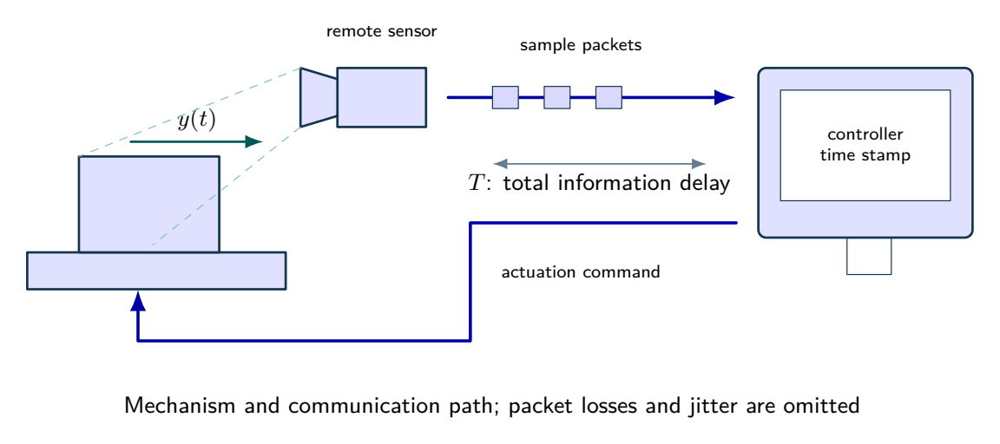
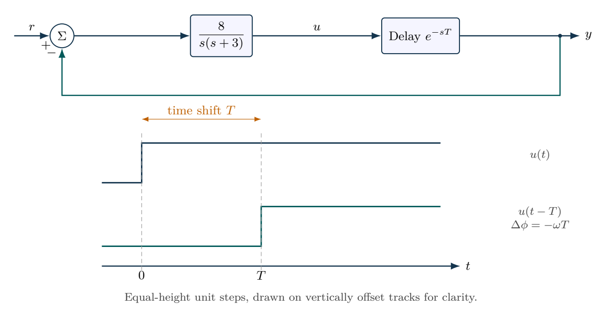

# A feedback loop with a communication delay

The normalized tracking loop is $L(s)=8/[s(s+3)]$. Find gain crossover $\omega_c$, phase margin $\phi_m$ and the first constant pure-delay stability boundary. Introduce delays $T=0.10\,\mathrm{s}$ and $0.30\,\mathrm{s}$. Compare fifth-order Pade approximation with exact phase $-\omega T$, explaining the scope of the rational approximation.

## Physical system

A remote mechanism sends measurements and receives commands through a communication path. The model combines those latencies into one ideal constant delay; the drawn packet train is not an experimental record.

## Mathematical structure

Constant pure delay shifts a signal in time and contributes frequency-dependent phase lag. The sketch shows ideal steps, not experimental records.

## Integrated practice

[Five problems with linked parts (PDF)](exercises.pdf) · [Worked reasoning (PDF)](exercise-solutions.pdf)

1. A remotely observed actuator
2. Allocating a finite phase budget
3. How a low-order delay approximation can overstate tolerance
4. Sensor dynamics invalidate a previously acceptable delay budget
5. Trading loop speed for delay tolerance and numerical fidelity

All parameters define an original hypothetical scenario. Submit derivations, labeled simulations, numerical checks and model limitations. No physical experiment is implied.
