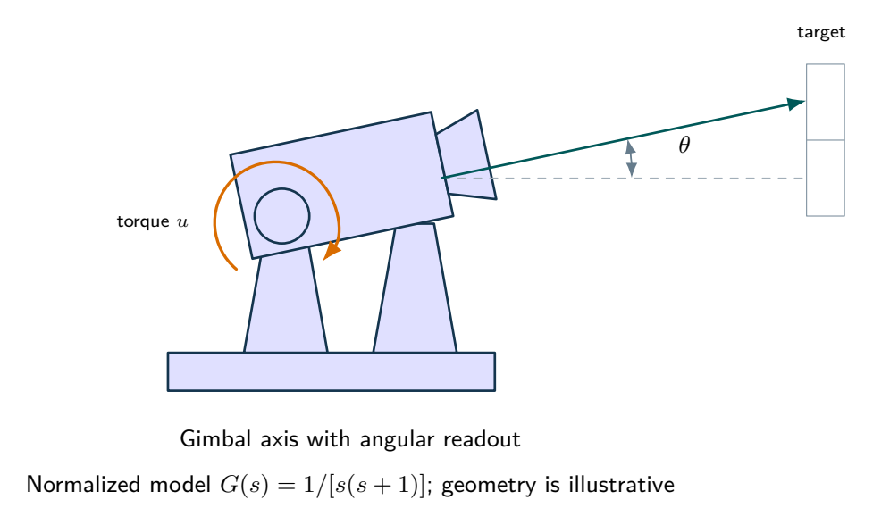
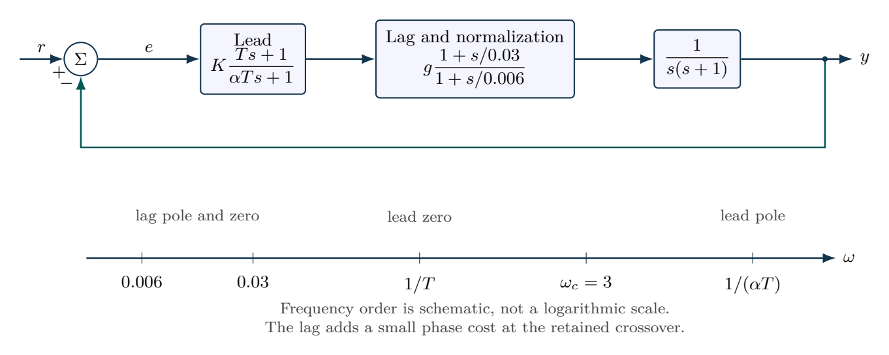

# Lead-lag design for a normalized camera axis

A meaningful compensation comparison needs both stability margin and low-frequency accuracy. Keep the slow lag transient visible when interpreting ramp error.

- [Original assignment](assignment.md)
- [Worked report PDF](report.pdf) and [LaTeX source](report.tex)
- [Executed notebook](notebook.ipynb) and [Python program](analysis.py)
- [MATLAB / GNU Octave implementation](../../matlab/run_lesson.m): `run_lesson(8)`

Run the Python program from this folder. See [validation](../../docs/VALIDATION.md) for actual execution status.

## Practice questions

Five integrated problems each contain three linked parts: model and analyze the situation, then resolve a design or evidence question. The separate worked-solution document repeats every part and develops its reasoning. All examples use hypothetical or synthetic data.

[Questions PDF](exercises.pdf) · [Solutions PDF](exercise-solutions.pdf) · [Questions LaTeX](exercises.tex) · [Solutions LaTeX](exercise-solutions.tex)

## Physical system

A camera gimbal illustrates angular tracking and disturbance rejection. Its normalized plant is stipulated, with no claim that geometry alone determines its two poles.

[Editable physical illustration](figures/physical-system.tikz)

## System diagram

Lead and lag sections are drawn separately so their gain normalization and frequency ordering can be analyzed independently.

[Editable TikZ](figures/system-diagram.tikz) · [Diagram atlas](../../docs/diagram-atlas.pdf)

## Position in the learning path

**Before starting:** 06--07 and steady tracking errors. **New demand:** Simultaneous tracking, phase and noise requirements. Recheck all requirements after adding the lag section. See the [prerequisite map and first-pass route](../../course/README.md).
