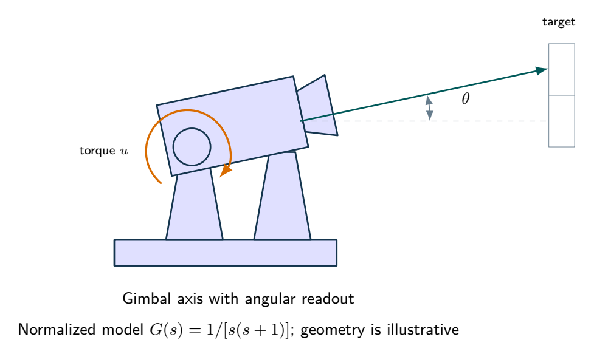
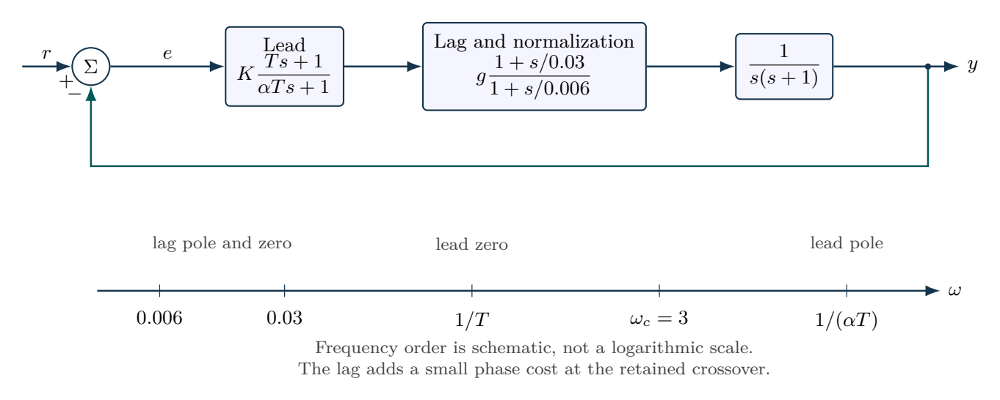

# Lead-lag design for a normalized camera axis

For $G(s)=1/[s(s+1)]$, design lead compensation with crossover $\omega_c=3\,\mathrm{rad/s}$ and target phase margin $55^\circ$, centering maximum lead at crossover. Add lag zero $0.03\,\mathrm{rad/s}$ and pole $0.006\,\mathrm{rad/s}$, then renormalize gain at $\omega_c$. Compare final phase margins, velocity constants $K_v$, ramp errors and reference responses.

## Physical system

A camera gimbal illustrates angular tracking and disturbance rejection. Its normalized plant is stipulated, with no claim that geometry alone determines its two poles.

## Mathematical structure

Lead and lag sections are drawn separately so their gain normalization and frequency ordering can be analyzed independently.

## Integrated practice

[Five problems with linked parts (PDF)](exercises.pdf) · [Worked reasoning (PDF)](exercise-solutions.pdf)

1. A camera axis with simultaneous speed and phase requirements
2. Realizing and normalizing a lead network
3. Improving ramp tracking without silently relaxing phase specifications
4. Spending the remaining phase reserve on a real communication link
5. A stable compensated output can still demand noisy actuator effort

All parameters define an original hypothetical scenario. Submit derivations, labeled simulations, numerical checks and model limitations. No physical experiment is implied.
