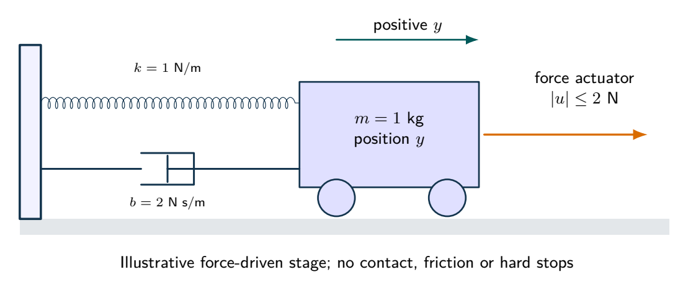
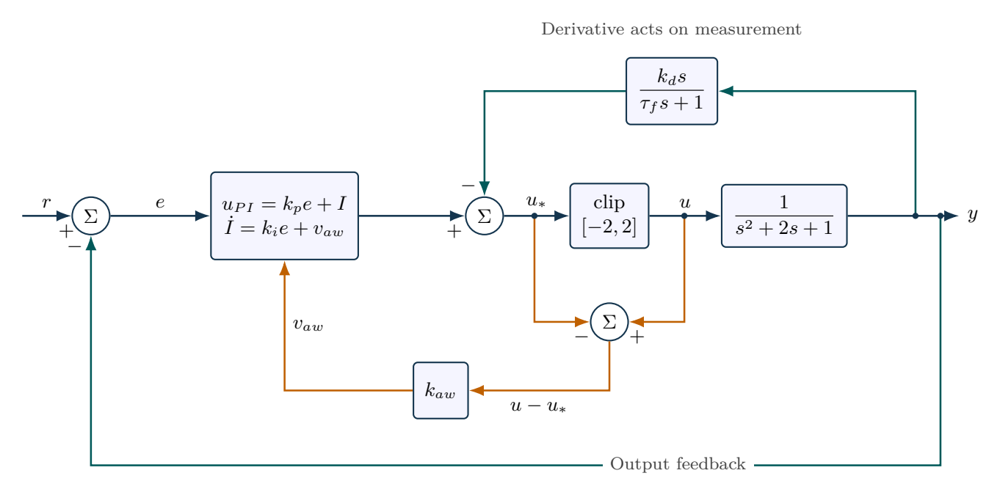

# PID regulation when the actuator saturates

An infeasible command cannot be repaired by controller gain. Anti-windup improves recovery after saturation rather than increasing physical actuator capacity.

- [Original assignment](assignment.md)
- [Worked report PDF](report.pdf) and [LaTeX source](report.tex)
- [Executed notebook](notebook.ipynb) and [Python program](analysis.py)
- [MATLAB / GNU Octave implementation](../../matlab/run_lesson.m): `run_lesson(9)`

Run the Python program from this folder. See [validation](../../docs/VALIDATION.md) for actual execution status.

## Practice questions

Five integrated problems each contain three linked parts: model and analyze the situation, then resolve a design or evidence question. The separate worked-solution document repeats every part and develops its reasoning. All examples use hypothetical or synthetic data.

[Questions PDF](exercises.pdf) · [Solutions PDF](exercise-solutions.pdf) · [Questions LaTeX](exercises.tex) · [Solutions LaTeX](exercise-solutions.tex)

## Physical system

A mass, spring, damper and bounded force actuator physically realize the normalized second-order plant. Force saturation is included; contact, dry friction and travel stops are not.

[Editable physical illustration](figures/physical-system.tikz)

## System diagram

Filtered derivative acts on measurement. Back-calculation sends the actual-minus-requested actuator effort into the integral-state equation.

[Editable TikZ](figures/system-diagram.tikz) · [Diagram atlas](../../docs/diagram-atlas.pdf)

## Position in the learning path

**Before starting:** 05--06 and numerical ODEs. **New demand:** Derivative filtering, saturation and anti-windup. Compare actual actuator effort as well as requested effort. See the [prerequisite map and first-pass route](../../course/README.md).
