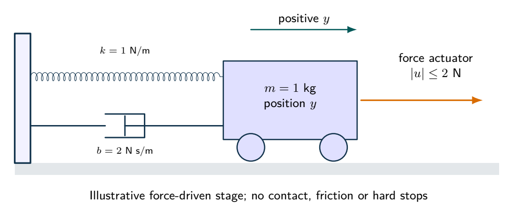
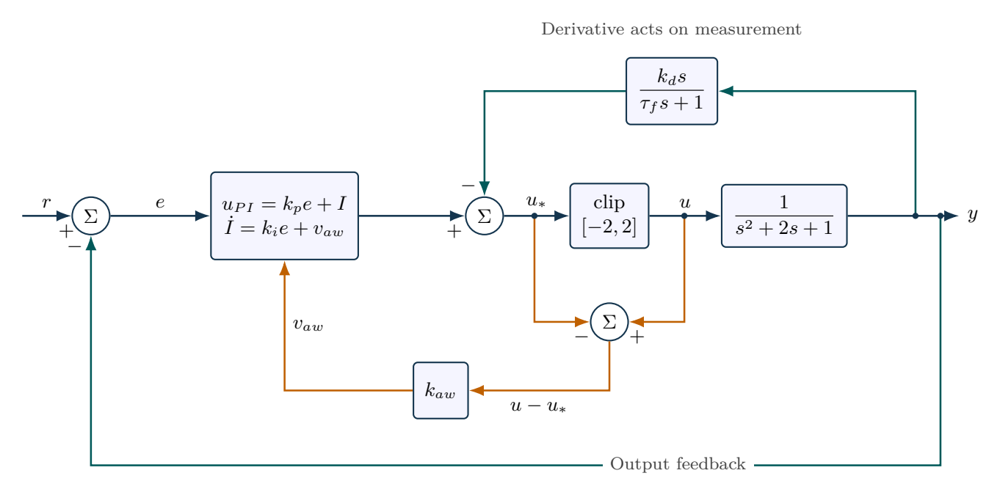

# PID regulation when the actuator saturates

A normalized position plant obeys $\ddot x+2\dot x+x=u$. Match ideal PID gains to poles $-2,-3,-4$. Implement derivative action on measured position using filter time constant $\tau_f=0.03\,\mathrm{s}$ and constrain $u\in[-2,2]$. Command $r=3$ for six seconds and then $r=0.2$. Compare ordinary integration with back-calculation gain $k_{aw}=8\,\mathrm{s^{-1}}$ and report recovery error over the final six seconds.

## Physical system

A mass, spring, damper and bounded force actuator physically realize the normalized second-order plant. Force saturation is included; contact, dry friction and travel stops are not.

## Mathematical structure

Filtered derivative acts on measurement. Back-calculation sends the actual-minus-requested actuator effort into the integral-state equation.

## Integrated practice

[Five problems with linked parts (PDF)](exercises.pdf) · [Worked reasoning (PDF)](exercise-solutions.pdf)

1. Pole placement for a force-limited positioning stage
2. Implementing a filtered controller as a state model
3. An unreachable reference with a bounded integral state
4. Anti-windup speed and numerical step-size limits
5. A reproducible recovery comparison with an explicit evidence limit

All parameters define an original hypothetical scenario. Submit derivations, labeled simulations, numerical checks and model limitations. No physical experiment is implied.
