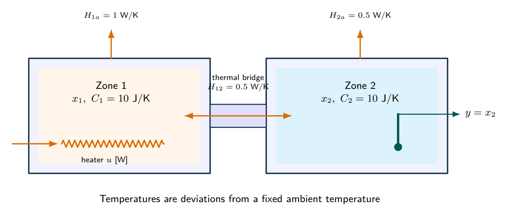
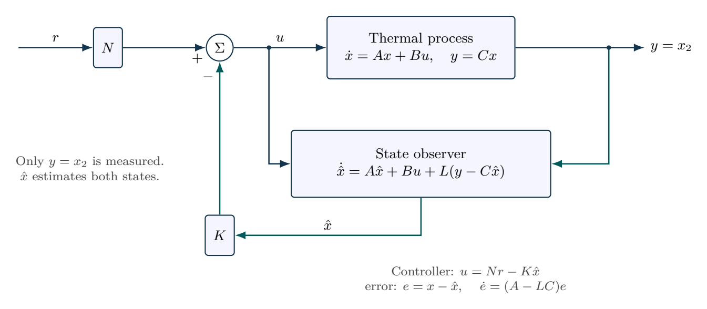

# Two thermal zones with one temperature measurement

State estimation and reference prefiltering solve different problems. A nominal prefilter does not replace integral action against unknown constant disturbances.

- [Original assignment](assignment.md)
- [Worked report PDF](report.pdf) and [LaTeX source](report.tex)
- [Executed notebook](notebook.ipynb) and [Python program](analysis.py)
- [MATLAB / GNU Octave implementation](../../matlab/run_lesson.m): `run_lesson(10)`

Run the Python program from this folder. See [validation](../../docs/VALIDATION.md) for actual execution status.

## Practice questions

Five integrated problems each contain three linked parts: model and analyze the situation, then resolve a design or evidence question. The separate worked-solution document repeats every part and develops its reasoning. All examples use hypothetical or synthetic data.

[Questions PDF](exercises.pdf) · [Solutions PDF](exercise-solutions.pdf) · [Questions LaTeX](exercises.tex) · [Solutions LaTeX](exercise-solutions.tex)

## Physical system

Two thermal inventories are connected by a conductive bridge. Heating acts in the first zone and sensing in the second. These stated capacities and conductances reproduce the two-state model exactly under the lumped assumptions.

[Editable physical illustration](figures/physical-system.tikz)

## System diagram

The observer receives both the applied control and measured output. Its estimated vector supplies state feedback; the prefilter sets nominal reference gain.

[Editable TikZ](figures/system-diagram.tikz) · [Diagram atlas](../../docs/diagram-atlas.pdf)

## Position in the learning path

**Before starting:** 04--05 state models, eigenvalues and 09 actuator limits. **New demand:** State feedback, estimation and implementation assumptions. Derive the full-state result before introducing the observer. See the [prerequisite map and first-pass route](../../course/README.md).
