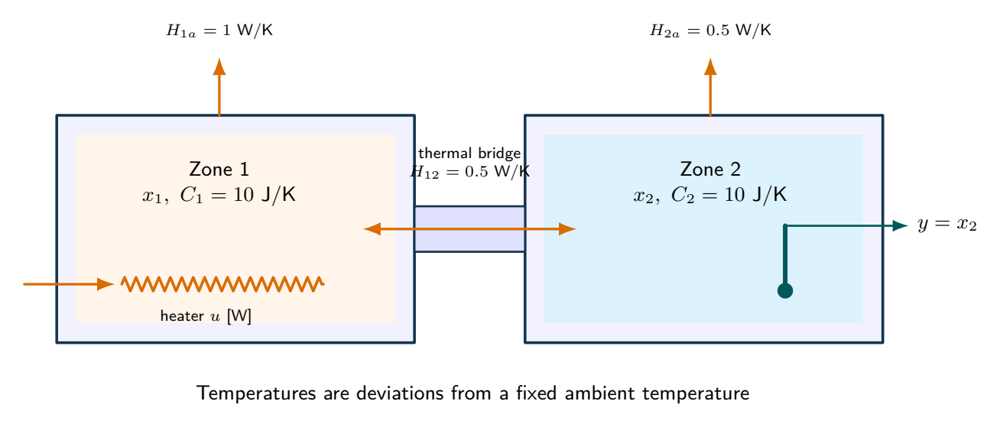
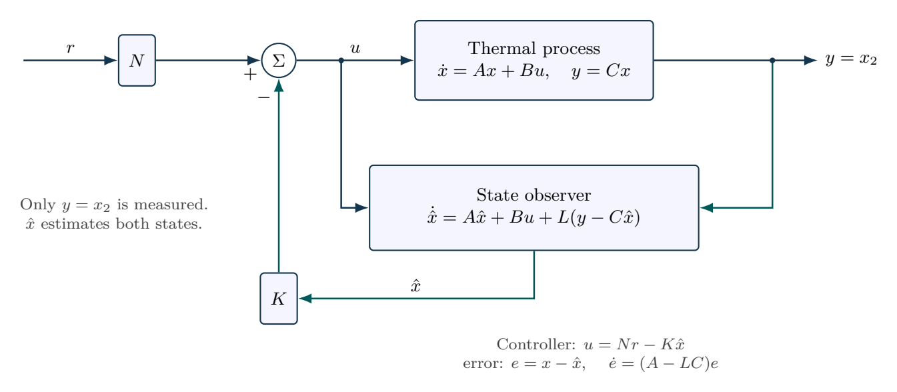

# Two thermal zones with one temperature measurement

Two hypothetical thermal zones obey $\dot x=Ax+Bu$ and $y=Cx$, with

$$
A=\begin{bmatrix}-0.15&0.05\\0.05&-0.10\end{bmatrix}\,\mathrm{s^{-1}},
\quad B=\begin{bmatrix}0.1\\0\end{bmatrix}\,\mathrm{K/(s\,W)},
\quad C=\begin{bmatrix}0&1\end{bmatrix}.
$$

Check controllability and observability. Choose feedback poles $-0.20,-0.35$, observer poles $-0.8,-1.0$ and a constant reference prefilter. Starting at $x(0)=[0.6,-0.4]^{\mathsf T}\,\mathrm{K}$ with zero estimate, regulate zone 2 to a $1\,\mathrm{K}$ rise.

## Physical system

Two thermal inventories are connected by a conductive bridge. Heating acts in the first zone and sensing in the second. These stated capacities and conductances reproduce the two-state model exactly under the lumped assumptions.

## Mathematical structure

The observer receives both the applied control and measured output. Its estimated vector supplies state feedback; the prefilter sets nominal reference gain.

## Integrated practice

[Five problems with linked parts (PDF)](exercises.pdf) · [Worked reasoning (PDF)](exercise-solutions.pdf)

1. Two thermal zones, one heater and one thermometer
2. Pole placement and the distinction between transient and steady feasibility
3. An observer must receive the input actually applied
4. Unknown heat leakage, actuator capacity and integral augmentation
5. Fast estimation, biased sensors and the limits of a noise-path calculation

All parameters define an original hypothetical scenario. Submit derivations, labeled simulations, numerical checks and model limitations. No physical experiment is implied.
