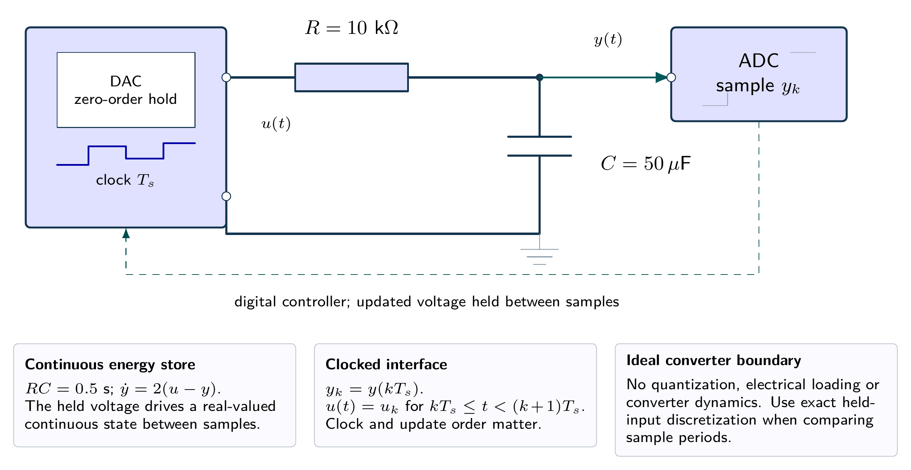
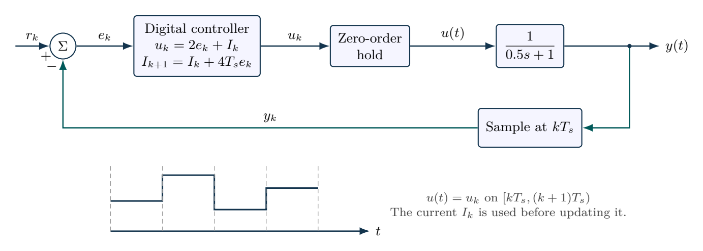

# Sampling can destabilize a continuous-time design

A stable continuous controller can fail after discretization. State the sampling rule and update order, then test the actual discrete closed-loop model.

- [Original assignment](assignment.md)
- [Worked report PDF](report.pdf) and [LaTeX source](report.tex)
- [Executed notebook](notebook.ipynb) and [Python program](analysis.py)
- [MATLAB / GNU Octave implementation](../../matlab/run_lesson.m): `run_lesson(11)`

Run the Python program from this folder. See [validation](../../docs/VALIDATION.md) for actual execution status.

## Practice questions

Five integrated problems each contain three linked parts: model and analyze the situation, then resolve a design or evidence question. The separate worked-solution document repeats every part and develops its reasoning. All examples use hypothetical or synthetic data.

[Questions PDF](exercises.pdf) · [Solutions PDF](exercise-solutions.pdf) · [Questions LaTeX](exercises.tex) · [Solutions LaTeX](exercise-solutions.tex)

## Physical system

A held voltage drives an ideal RC network. The capacitor voltage is sampled by an ideal ADC; the software controller updates the DAC once per period. Quantization, converter lag and electrical loading are omitted.

[Editable physical illustration](figures/physical-system.tikz) · [Vector equipment PDF](figures/physical-system.pdf)

## System diagram

The sampler, digital update order and hold are explicit. Continuous plant dynamics and sampled controller states occupy different parts of the loop.

[Editable TikZ](figures/system-diagram.tikz) · [Diagram atlas](../../docs/diagram-atlas.pdf)

## Position in the learning path

**Before starting:** 05 PI control, 10 state models and difference equations. **New demand:** Sampling stability and software update order. Specify the held input and integrator update order first. See the [prerequisite map and first-pass route](../../course/README.md).
