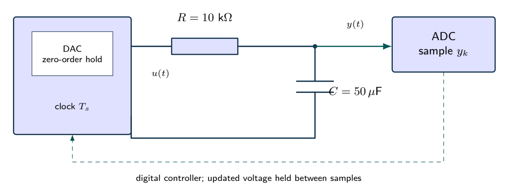
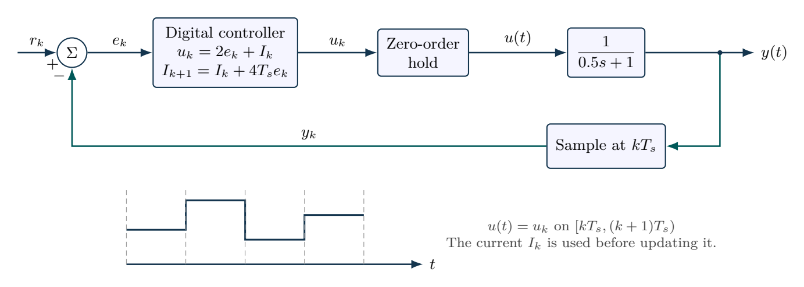

# Sampling can destabilize a continuous-time design

For $G(s)=1/(0.5s+1)$, use PI gains $k_p=2$ and $k_i=4$ with a held actuator. Apply $u_k=2(r_k-x_k)+I_k$ before updating $I_{k+1}=I_k+4T_s(r_k-x_k)$. Derive the exact sampled plant update and two-state closed-loop matrix. Compare $T_s=0.05$, $0.5$ and $1.0\,\mathrm{s}$ and find the first discrete-time stability boundary.

## Physical system

A held voltage drives an ideal RC network. The capacitor voltage is sampled by an ideal ADC; the software controller updates the DAC once per period. Quantization, converter lag and electrical loading are omitted.

## Mathematical structure

The sampler, digital update order and hold are explicit. Continuous plant dynamics and sampled controller states occupy different parts of the loop.

## Integrated practice

[Five problems with linked parts (PDF)](exercises.pdf) · [Worked reasoning (PDF)](exercise-solutions.pdf)

1. A sampled controller connected to a continuous RC circuit
2. A stability proof instead of a sampling-rate guess
3. The onset of sustained sampled oscillations
4. An equilibrium is not a convergence guarantee
5. Implementation order and what happens between samples

All parameters define an original hypothetical scenario. Submit derivations, labeled simulations, numerical checks and model limitations. No physical experiment is implied.
