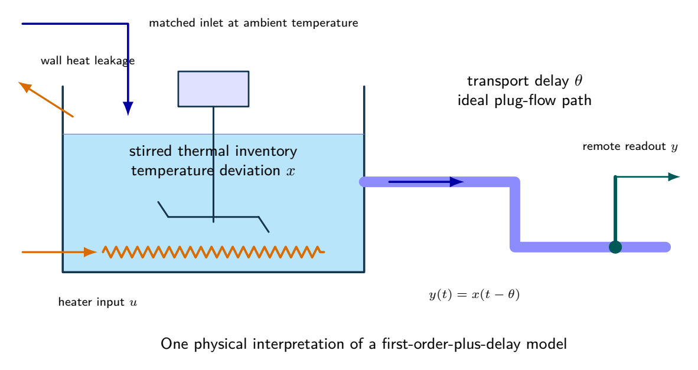
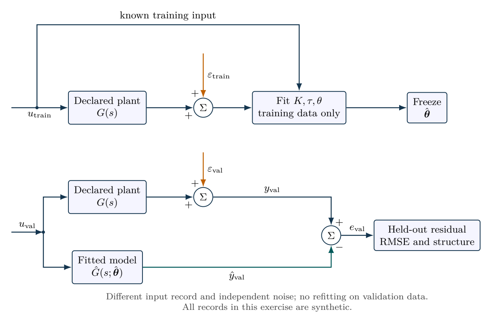

# A synthetic process from identification to validation

Training, validation and controller evaluation answer different questions. All three records are synthetic here; experimental claims require independently collected measurements.

- [Original assignment](assignment.md)
- [Worked report PDF](report.pdf) and [LaTeX source](report.tex)
- [Executed notebook](notebook.ipynb) and [Python program](analysis.py)
- [MATLAB / GNU Octave implementation](../../matlab/run_lesson.m): `run_lesson(12)`

Run the Python program from this folder. See [validation](../../docs/VALIDATION.md) for actual execution status.

## Practice questions

Five integrated problems each contain three linked parts: model and analyze the situation, then resolve a design or evidence question. The separate worked-solution document repeats every part and develops its reasoning. All examples use hypothetical or synthetic data.

[Questions PDF](exercises.pdf) · [Solutions PDF](exercise-solutions.pdf) · [Questions LaTeX](exercises.tex) · [Solutions LaTeX](exercise-solutions.tex)

## Physical system

A stirred thermal inventory followed by ideal transport is one possible physical interpretation of the identified transfer function. The effective conductance includes wall leakage and through-flow heat removal. Its fitted gain and time constant do not separately determine capacity, conductance and heater efficiency.

[Editable physical illustration](figures/physical-system.tikz)

## System diagram

Training selects parameters; held-out validation freezes them. Separate noise records avoid reusing training residuals as validation evidence.

[Editable TikZ](figures/system-diagram.tikz) · [Diagram atlas](../../docs/diagram-atlas.pdf)

## Position in the learning path

**Before starting:** 02, 05, 07, 09, 11 and basic probability/least squares. **New demand:** Identification, independent validation and fractional delays. The chi-square interval in 3(c) needs a probability refresher. See the [prerequisite map and first-pass route](../../course/README.md).
