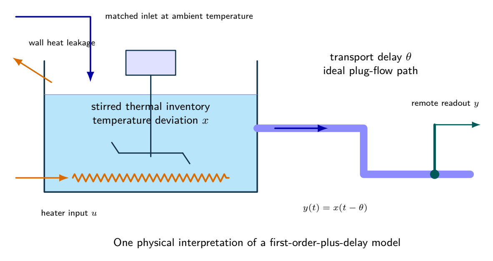
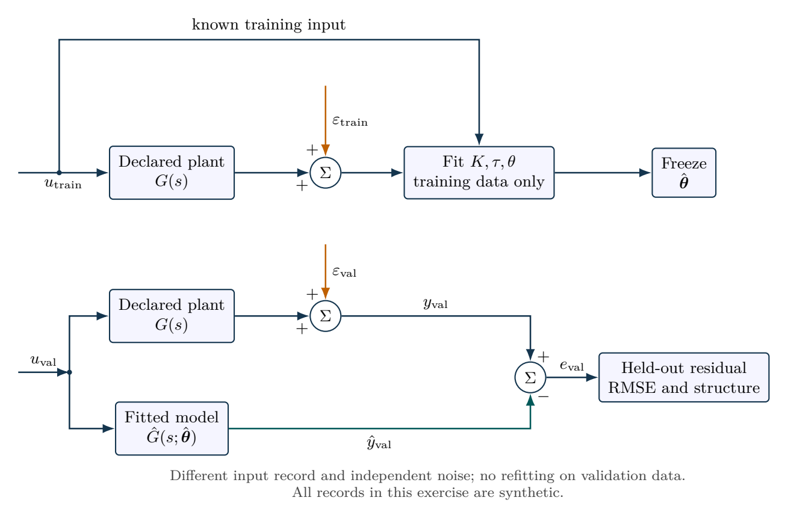

# A synthetic process from identification to validation

Create a reproducible synthetic identification experiment with gain $K=1.8$, time constant $\tau=4\,\mathrm{s}$ and delay $\theta=0.6\,\mathrm{s}$. Apply a two-unit step at $t=2\,\mathrm{s}$, sample every $0.05\,\mathrm{s}$ and add independent Gaussian noise with standard deviation $0.015$ using seed 2026. Estimate the parameters without initializing at truth, validate on a separate multistep record, and tune PI using $\lambda=2\,\mathrm{s}$. Assess the delayed closed loop with $u\in[0,2]$, distinguishing training, validation and simulated controller evaluation.

## Physical system

A stirred thermal inventory followed by ideal transport is one possible physical interpretation of the identified transfer function. The effective conductance includes wall leakage and through-flow heat removal. Its fitted gain and time constant do not separately determine capacity, conductance and heater efficiency.

## Mathematical structure

Training selects parameters; held-out validation freezes them. Separate noise records avoid reusing training residuals as validation evidence.

## Integrated practice

[Five problems with linked parts (PDF)](exercises.pdf) · [Worked reasoning (PDF)](exercise-solutions.pdf)

1. Inferring an aggregate thermal process from a step
2. Fitting a delayed model without leaking validation information
3. A held-out multistep test with a statistical reference
4. Tuning a PI law subject to uncertain steady capability
5. Implementing a noninteger transport delay

All parameters define an original hypothetical scenario. Submit derivations, labeled simulations, numerical checks and model limitations. No physical experiment is implied.
