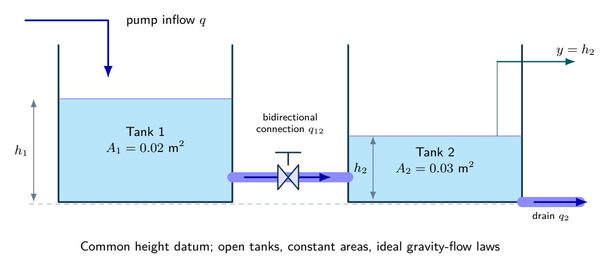
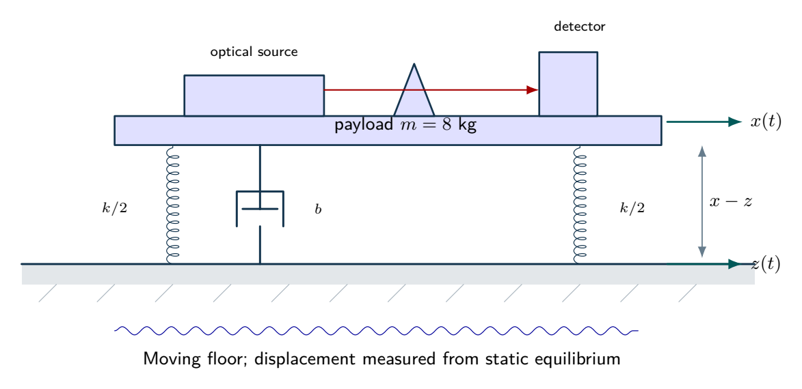
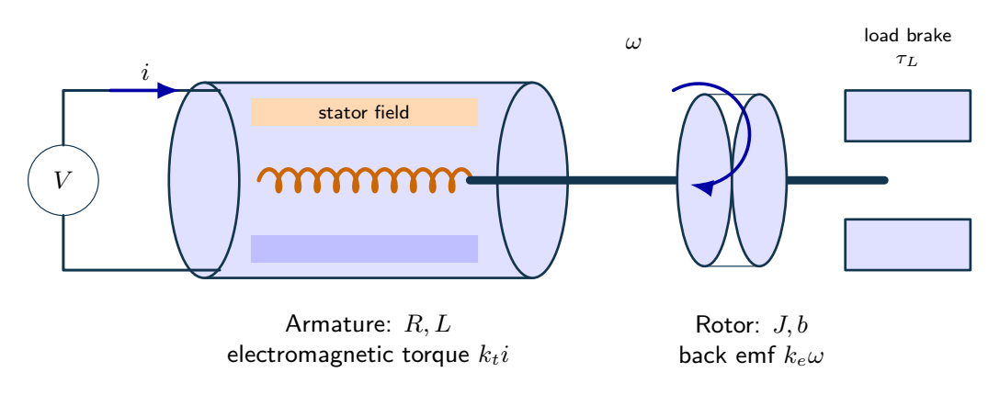

# Five integrated design studies

Five original cases, each with six linked parts, bring modeling, analysis and design constraints together. [Exercise PDF](exercises.pdf) · [Worked solutions](solutions.pdf) · [Exercise LaTeX](exercises.tex) · [Solution LaTeX](solutions.tex)

## 1. Interacting water tanks: from flow laws to a feasible controller

Two open tanks have constant areas $A_1=0.02$ m$^2$ and $A_2=0.03$ m$^2$. Their submerged connection obeys

$$
q_{12}=k_{12}\operatorname{sgn}(h_1-h_2)\sqrt{|h_1-h_2|},\qquad
q_2=k_2\sqrt{h_2},
$$

where $k_{12}=0.004$ and $k_2=0.003$ m$^{5/2}$/s. The pump feeds only tank 1. Nominal inflow is $\bar q=0.0012$ m$^3$/s; the measured output is $h_2$. Areas and discharge coefficients are hypothetical. Assume nonnegative levels, no overflow and ideal sensing.

**(a)** Starting from conservation of volume, derive the nonlinear state equations. Find both equilibrium heights and explain why the connection flow depends on a level difference.

**(b)** Linearize about that equilibrium using deviation variables. Derive the transfer function from inflow to the second level, its poles and its DC gain. State where the linearization ceases to be differentiable.

**(c)** Increase the constant inflow by $10^{-4}$ m$^3$/s. Compare the linear and exact equilibrium changes of $h_2$, expressing the error relative to the exact change. Explain why a small input increment is not a universal accuracy certificate.

**(d)** Use deviation PI control $\delta q=k_p(r-\delta h_2)+k_i\int(r-\delta h_2)\,dt$. Derive the characteristic polynomial and the strict stability region for positive gains. Check $k_p=0.001$ m$^2$/s and $k_i=0.0001$ m$^2$/s$^2$.

**(e)** The pump is limited to $0\le q\le0.0015$ m$^3$/s. Can the second level be held at 0.30 m? Determine the highest feasible equilibrium level and describe the implication for integral action.

**(f)** Propose a simulation and identification protocol that could falsify the local model. Include initial conditions, reverse connection flow, numerical convergence and the distinction between simulation and physical validation.

## 2. Optical isolation with conflicting stiffness and travel requirements

A hypothetical optical bench of mass $m=8$ kg sits on a parallel spring and viscous damper, with total stiffness $k=3200$ N/m and damping ratio $\zeta=0.08$. The floor displacement is $z(t)$ and payload displacement is $x(t)$, measured about static equilibrium. The floor can oscillate at 40 rad/s with amplitude 0.5 mm. The design brief asks for less payload motion than floor motion, static sag at most 3 mm and relative travel amplitude at most 0.6 mm.

**(a)** Draw the force balance and derive both $X/Z$ and $(X-Z)/Z$. Compute the natural frequency and damper coefficient; explain why replacing floor motion by an applied force changes the numerator.

**(b)** Evaluate absolute displacement and relative travel at the stated excitation. Check the two dynamic requirements separately.

**(c)** Show that displacement isolation occurs only above $\sqrt2\,\omega_n$, independently of positive damping. Combine this with the sag requirement to decide whether any passive linear spring can satisfy both specifications at 40 rad/s.

**(d)** Would raising the damping ratio to 0.4 cure the travel issue without a cost? Calculate the two amplitudes at 40 rad/s and compare resonance and high-frequency behavior.

**(e)** Derive an energy balance valid for a moving base. Explain why energy need not decrease even when the damper is passive.

**(f)** Write a justified design decision and a minimum validation plan, including what can and cannot be inferred from a simulated frequency-response curve.

## 3. A motor speed servo under voltage and load constraints

A hypothetical DC motor has $R=2\,\Omega$, $L=0.02$ H, $J=0.01$ kg m$^2$, $b=0.02$ N m s/rad, $k_t=0.1$ N m/A and $k_e=0.1$ V s/rad. The load torque is 0.03 N m. The requested speed is 5 rad/s and the voltage limit is $|V|\le2$ V. Positive torque and speed use the same orientation.

**(a)** Derive the electrical and mechanical state equations, the voltage-to-speed transfer and the load-to-speed transfer. Identify the approximation made when armature inductance is neglected.

**(b)** Calculate the voltage and current required at the requested speed. Find the largest nonnegative equilibrium speed at the voltage limit and verify steady power balance there.

**(c)** Ignore saturation temporarily and design a PI controller on the reduced plant with desired poles at $-3$ and $-5$ s$^{-1}$. Derive the gains, then test the full electrical-mechanical characteristic polynomial for stability.

**(d)** For a constant feasible reference, explain why ideal PI control removes a constant load offset. Derive the closed-loop load channel and reconcile zero asymptotic error with the infeasible 5 rad/s target.

**(e)** An estimator uses $\widehat{\tau}_L=(k_t/R)V-(b+k_tk_e/R)\omega$. Derive its bias during acceleration and explain what extra information would remove that bias.

**(f)** Propose a revised feasible speed brief and a test that distinguishes controller performance from actuator feasibility. Include anti-windup, initial conditions and parameter uncertainty.

## 4. Camera tracking: lead-lag design with a network-delay budget

A normalized camera axis has $G(s)=1/[s(s+1)]$ under unity negative feedback. Design crossover is 3 rad/s and desired phase margin is $55^\circ$. Use $C_{\ell}=K(1+Ts)/(1+\alpha Ts)$, $0<\alpha<1$. A later requirement asks for unit-ramp error at most 0.05. A possible lag stage is $F=(1+s/0.03)/(1+s/0.006)$; a constant delay may also be present.

**(a)** Show why scalar gain alone cannot meet the crossover and phase-margin targets simultaneously. Determine the needed lead phase.

**(b)** Place maximum lead at the design crossover and derive $\alpha,T,K$. Verify both the magnitude and phase conditions rather than using rounded parameters alone.

**(c)** Find the lead-only ramp error. Add the specified lag, normalize its magnitude at 3 rad/s by a scalar $g$, and compute the new ramp error and phase margin. Does the combined design satisfy both original requirements?

**(d)** For the combined compensator, derive the first constant-delay stability boundary and the maximum delay that retains $40^\circ$ phase margin. Assess 0.09 s delay.

**(e)** Derive the high-frequency measurement-noise-to-control limit. Explain why small output noise need not imply small actuator activity.

**(f)** Write a defensible acceptance decision for the current design and specify which calculations must be repeated after retuning.

## 5. Two-zone temperature regulation with estimation and sampled actuation

Two lumped thermal zones each have capacity 10 J/K. Their mutual conductance is 0.5 W/K; conductances to a fixed ambient are 1 and 0.5 W/K, respectively. Heat input acts in zone 1 and only zone 2 is measured. States are temperature deviations in K. The nominal feedback pole targets are $-0.20,-0.35$ s$^{-1}$; observer targets are $-0.8,-1.0$ s$^{-1}$. A later implementation holds each input constant between samples.

**(a)** Derive $A,B,C$ from heat balances and test controllability and observability. Explain physically what is lost when the mutual conductance is zero.

**(b)** Find $K$ for $u=-Kx+Nr$ and the reference prefilter $N$. Derive the equilibrium heat input and distinguish transient and equilibrium feasibility for a 0.5 K step with a 2 W upper limit.

**(c)** Find the observer gain and derive the augmented dynamics in coordinates $[x,e]$, where $e=x-\hat x$. Explain which control signal the observer must receive under saturation.

**(d)** An unknown constant heat disturbance enters zone 2. Explain why the prefilter does not remove its offset and test whether adding an error integrator preserves controllability.

**(e)** For full-state sampled feedback with the same $K$, derive the exact held-input transition matrix. Compare sampling periods 1 s and 10 s. Explain why exponentiating $A-BK$ would answer a different implementation question.

**(f)** Specify a validation protocol that separates observer convergence, constant bias, sampled stability and experimental evidence.

